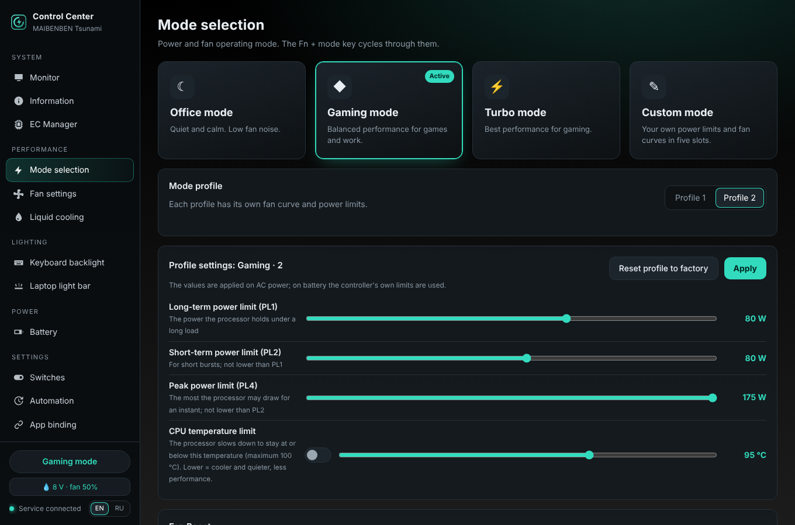
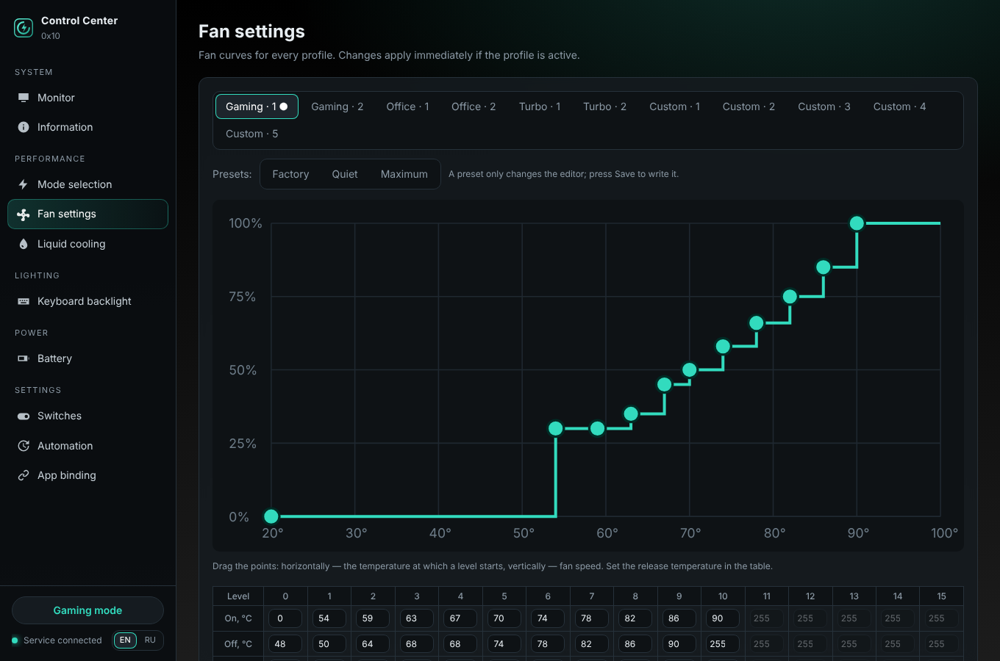
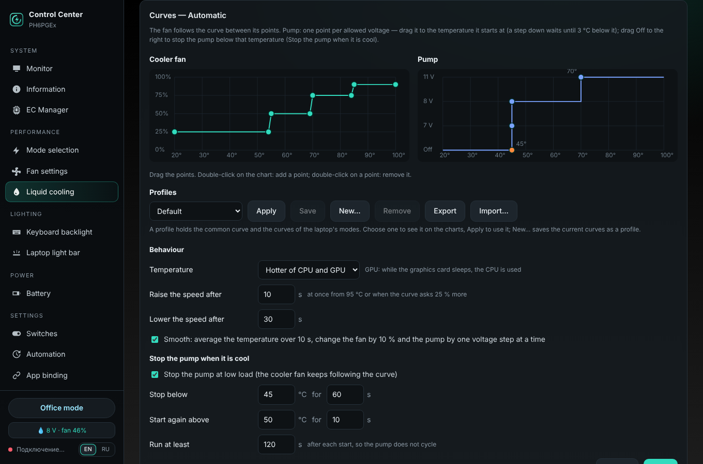

# open-uniwill-cc

**English** · [Русский](README.ru.md)

An open replacement for the **Uniwill "Control Center"** (5.52.x) of Uniwill-based gaming laptops, for
**Linux** and **Windows**: performance modes, fan curves, CPU/GPU power limits, RGB keyboard, battery care,
hardware switches — plus Bluetooth control of the **XMG Oasis** liquid cooler and its twins.

> **Unofficial.** Not affiliated with or supported by Uniwill or any laptop vendor. It writes to the embedded
> controller (EC) of your laptop exactly like the original service does, but use it at your own risk.
> The original Control Center can be restored at any time (see *Uninstall*).

> [!WARNING]
> **AI-generated project.** All source code, documentation and other text in this repository were generated by an
> AI model at the request and under the direction of the maintainer. The maintainer tested the program on a real
> laptop (see *Tested on*). Review the code before relying on it.

<p align="center">
  
  
  
  
</p>

## Features

- **Modes** Office / Gaming / Turbo (and **Custom** with 5 named slots on platforms that have it), the Fn mode key, Fan Boost
- **Power limits** PL1 / PL2 / PL4, NVIDIA cTGP and Dynamic Boost — within the limits the firmware reports
- **Temperature limits** per mode / profile: CPU in °C (85–100 °C, optionally down to 60 °C) and NVIDIA GPU target
  temperature
- **Fan curves** for CPU and GPU (16 points), presets, reset to factory
- **Keyboard lighting**: 17 hardware effects, per-key colours, gaming zones, software effects, auto-off;
  **chassis light bar** (rear / base / logo zones)
- **Battery**: protection modes, custom charge limits, USB-C charging priority
- **Switches**: Win-key lock, Fn lock, touchpad, USB power in sleep, power-on with AC, MUX (dGPU direct), webcam
- **Monitoring**: temperatures, load, clocks, fans, CPU and GPU power, memory, drives, battery; one-hour history
  with export to CSV / JSON / PNG
- **Automation**: mode per power source, overheating alerts (with optional Fan Boost), app → mode binding
- **Liquid cooler** XMG Oasis (LCT21001 Mk1 / LCT22002 Mk2), Eluktronics Liquid Pad Pro, PCS Liquid Series,
  TUXEDO Aquaris: automatic temperature tiers, follow-the-laptop mode, lighting, coolant flow guard, filling cycle
- **English and Russian** interface; tray app with notifications on Windows; desktop notifications on Linux
- **Backup and transfer**: export / import of fan curves (one or all), full backup, import from the original Control Center
- **Update check** against the GitHub releases (once a day, can be switched off); on Windows download, checksum check and
  install from the window or the tray
- **Diagnostic report** for bug reports and new laptops (privacy options, send via GitHub or e-mail)
- **`uwccctl`** command line tool on both systems

Full list with the EC registers behind each feature: [docs/FEATURES.md](docs/FEATURES.md).

## Supported laptops

The program reads the **project ID** from the EC and supports the same platforms as Control Center 5.52.x (MBB):

| Family | Projects |
|---|---|
| PHxT | PH4TRX1, PH4TUX1, PH4TQx1, PH6TRX1, PH6TQxx |
| PHxA | PH4ARxx, PH4AUxx, PH4AXxx, PH6AQxx, PH6ARxx, PH6AGxx, PH4AUxf |
| PHxP | PH4PRxx, PH4PUxx, PH4PGx1, PH4PGx2, PH6PRxx, PH6PGEx, PH6PG0x, PH6PG3x, PH6PG7x (also 150 W), PH4AQE3 |
| other Uniwill projects with RamFan 1.5 | e.g. `0x10` — Custom-mode platforms |

These chassis are sold under many brands (MAIBENBEN, XMG/Schenker, Eluktronics, Mechrevo, Thunderobot, …).
Run `uwccctl status` — the first line shows the project. **Not supported:** Tongfang GK/GM barebones (different EC),
Clevo, Uniwill laptops that shipped with Control Center 3.x.

**Tested on**

| Laptop | CPU / GPU | Project | BIOS / EC | Linux | Windows |
|---|---|---|---|---|---|
| MAIBENBEN Tsunami Series | i9-12900HX / NVIDIA | `0x10` | N.1.23A14 / 1.13 | ✅ Ubuntu 24.04 | ✅ Windows 11 24H2 |

Tested yours? Please open a [model report](https://github.com/aspidovss/open-uniwill-cc/issues/new?template=model_report.yml).

**Your laptop is not supported or something does not work?** Create a diagnostic report: *Information → Diagnostic
report → Create report* (or `uwccctl report`). It collects what is needed to add a platform — EC registers, BIOS
settings, keyboard / light bar devices, NVIDIA limits, the log — without serial numbers, MAC addresses or user names
(those can be ticked separately if asked). Attach the zip to an issue or send it to **OUCC@aspidov.ru**.

## Download

From [Releases](https://github.com/aspidovss/open-uniwill-cc/releases):

| File | For |
|---|---|
| `open-uniwill-cc-windows-<ver>-setup.exe` | Windows 10/11 x64 — installer |
| `open-uniwill-cc-windows-<ver>-portable.zip` | Windows — the same, installed with `install.ps1` |
| `open-uniwill-cc-linux-<ver>.tar.gz` | Ubuntu / Debian-based Linux (installer uses apt; developed on Ubuntu 24.04) |
| `SHA256SUMS.txt` | checksums |

## Installation

### Windows

1. Run `open-uniwill-cc-windows-<ver>-setup.exe` and keep **"Disable the original Control Center service"** ticked
   (two programs must not drive the same EC).
2. The icon appears in the notification area. The program **starts with Windows hidden in the tray**;
   click the icon (or *Start → UWCC Control Center*) to open the window.

Portable zip: unpack, then in PowerShell `powershell -ExecutionPolicy Bypass -File .\install.ps1` (asks for admin rights).

What gets installed: the `uwccd` service (LocalSystem), `ControlCenter.exe` (tray / window),
`uwccctl.exe` (console), and the OEM ACPI driver `UWACPIDriver` if it is not installed yet.
Details: [README.windows.md](README.windows.md).

### Linux

```bash
tar xzf open-uniwill-cc-linux-<ver>.tar.gz
cd open-uniwill-cc-<ver>
sudo bash install.sh
```

Then log out and in (your user joins the `uwcc` group) and start **Control Center** from the menu or run `uwcc`.
The installer builds the `uwcc` kernel module with DKMS (falls back to `acpi_call` if it cannot load).

**Secure Boot:** if `modprobe uwcc` says *Key was rejected*, run
`sudo mokutil --import /var/lib/shim-signed/mok/MOK.der`, reboot and choose *Enroll MOK*.
**TUXEDO Control Center** drives the same EC — the installer stops `tccd`; do not run both.

## Usage

- **Window** — all settings; the language switch (EN / RU) is at the bottom of the side bar.
- **Tray (Windows)** — right click: mode, Fan Boost, keyboard backlight, liquid cooler, language, updates, *Start with Windows*.
- **Console** (`uwccctl` on Linux, `uwccctl.exe` on Windows):

```text
uwccctl status                   mode, fans, temperatures, battery, cooler
uwccctl mode office|gaming|turbo|custom
uwccctl profile 1                profile of the current mode
uwccctl boost on|off             Fan Boost
uwccctl kb off|on|effect N       keyboard backlight
uwccctl lc scan / connect ADDR   liquid cooler: find / connect
uwccctl lc mode auto|ec|low|medium|high|off
uwccctl lang en|ru
uwccctl history csv out.csv      last hour of sensors to a file
uwccctl debug on|off             verbose service log
uwccctl export all backup.json   fan curves, profiles and settings to a file
uwccctl import backup.json       fan curves and profiles back (add fans,profiles,settings to choose)
uwccctl update                   check for a new release
uwccctl report                   diagnostic report (zip) for bug reports and new laptops
uwccctl restart                  restart the service (administrator / root)
```

## Uninstall / back to the original

- **Windows:** *Settings → Apps → UWCC Control Center → Uninstall* (or `uninstall.ps1`). Fan control is handed back to
  the EC and the original `GCUService` is re-enabled.
- **Linux:** `sudo bash uninstall.sh` (`--purge` also removes settings from `/var/lib/uwcc`).

## Safety

- Only the EC registers the original service writes, written the same way. If the EC does not report RamFan 1.5,
  modes and fan curves stay disabled.
- Fan curves and cooler tiers are validated before writing; risky settings ask for confirmation.
- The UEFI variable `UniWillVariable` is written only after its layout has been verified.
- The service listens on `127.0.0.1` only and requires a token readable by local users / group `uwcc`.
  See [SECURITY.md](SECURITY.md).

## Troubleshooting, building, debugging

[docs/BUILD.md](docs/BUILD.md) — building the Linux and Windows packages, running without hardware (`--mock`),
debug logging, where the logs are, what to attach to a bug report.

## Contact

- Bugs, questions, new laptops: [GitHub issues](https://github.com/aspidovss/open-uniwill-cc/issues)
- E-mail: **OUCC@aspidov.ru** (also for security reports, see [SECURITY.md](SECURITY.md))

## License

MIT — see [LICENSE](LICENSE), **except** `kernel/` (GPL-2.0), and `proprietary/` and `uwccd/lighting/oem/`
(OEM files and OEM-derived code, all rights reserved by their owners, included for interoperability).
Credits and the projects that helped: [NOTICE.md](NOTICE.md).
