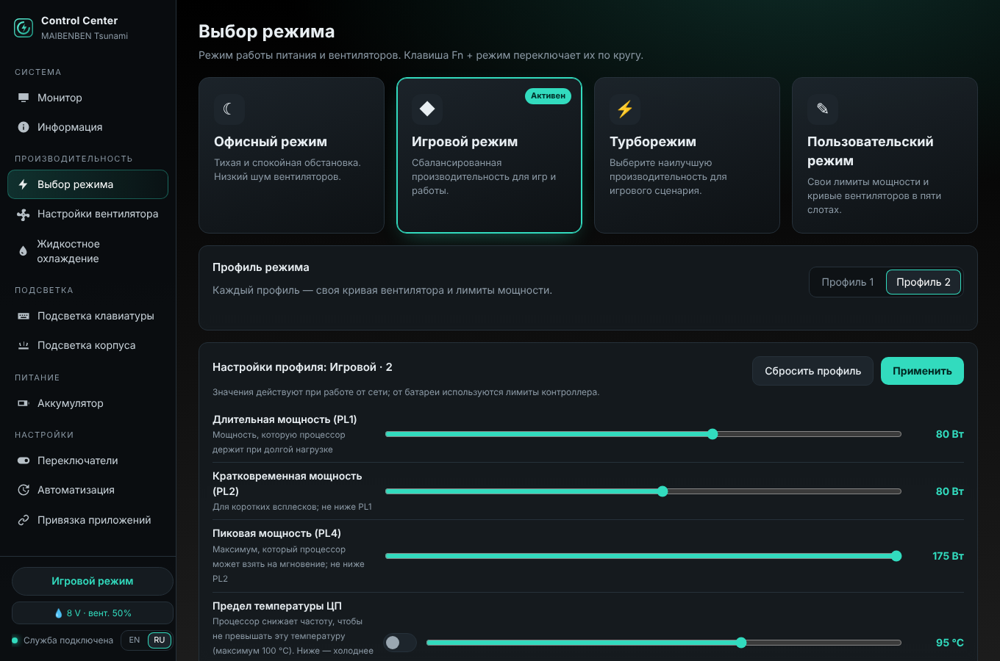
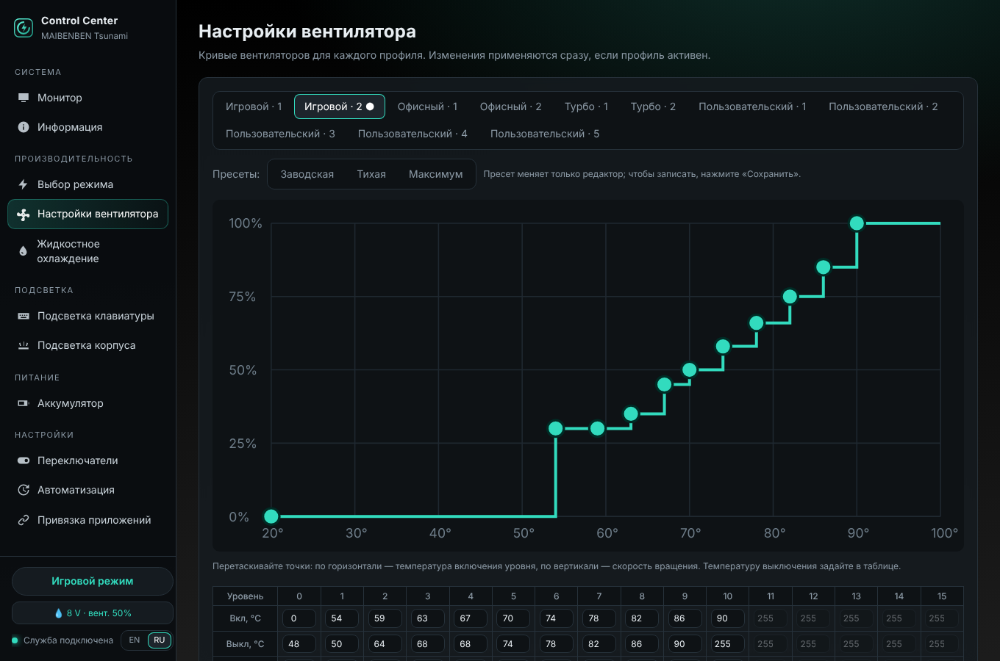
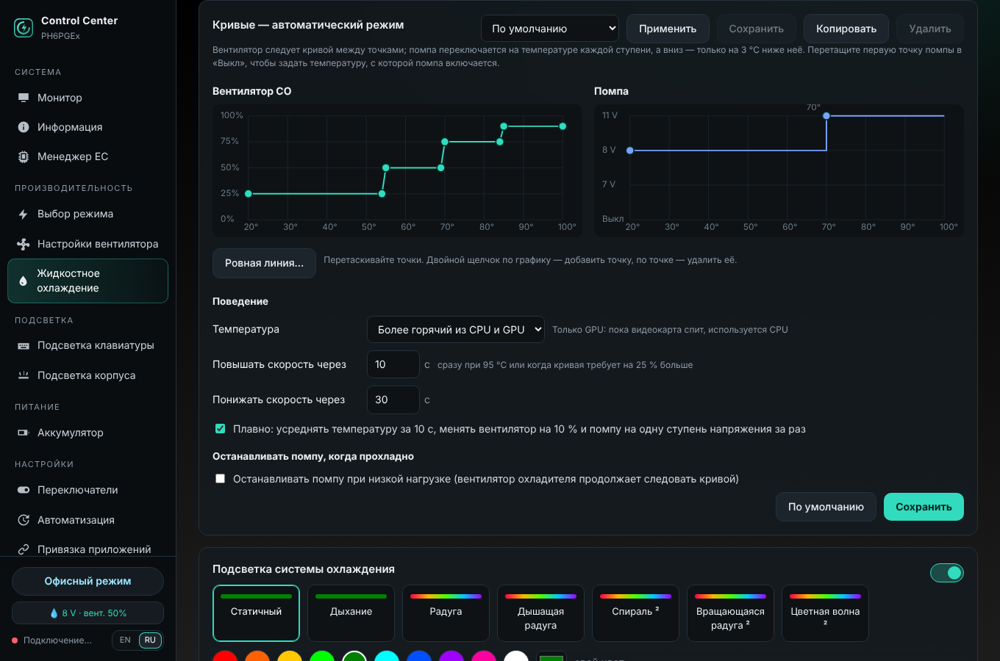
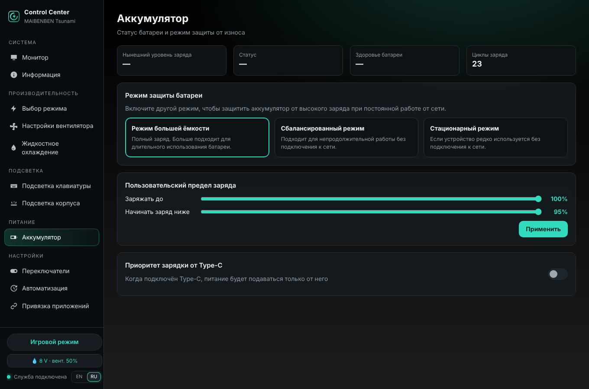
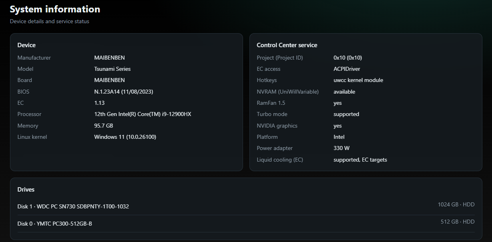
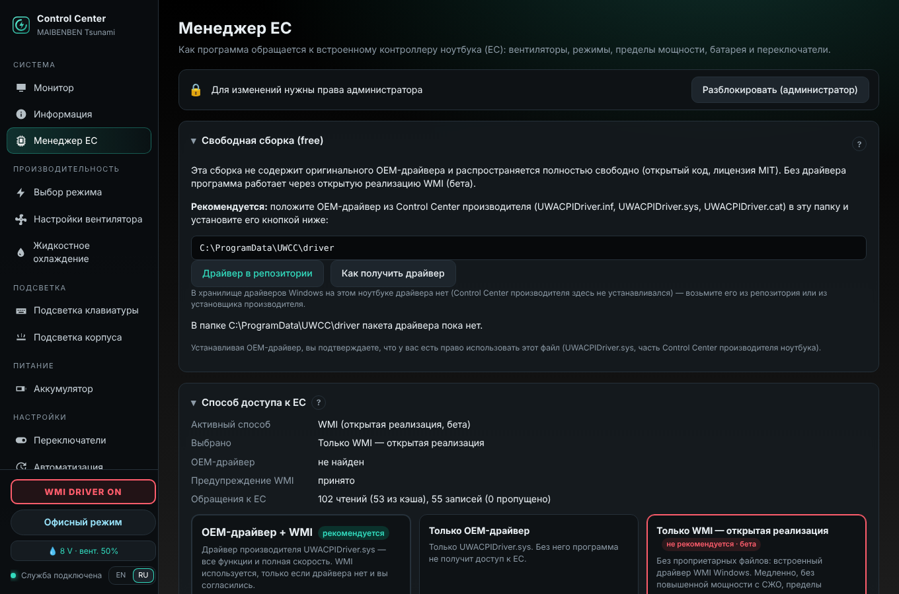
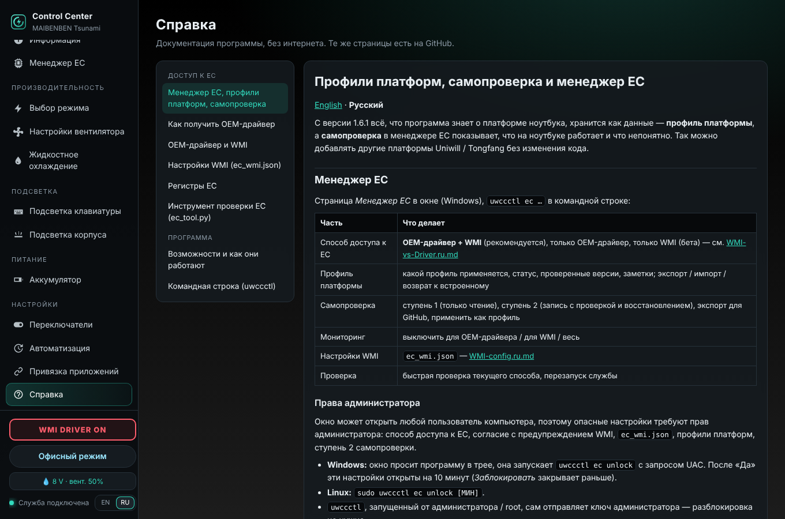

<p align="center">
  
</p>

<h1 align="center">open-uniwill-cc</h1>

<p align="center"><b>Открытый Control Center для ноутбуков на Uniwill — режимы, вентиляторы, мощность, подсветка, СЖО. Без слежки.</b></p>

<p align="center"><b>Возможно, первый на 100&nbsp;% открытый Control Center для Windows и Linux, которому не нужны сторонние драйверы.</b></p>

<p align="center"><a href="README.md">English</a> · <b>Русский</b> · <a href="docs/STRUCTURE.ru.md">Структура проекта</a> · <a href="docs/CLI.ru.md">Командная строка</a></p>

<p align="center">
  <a href="https://github.com/aspidovss/open-uniwill-cc/releases/latest"></a>
</p>

<p align="center">
  <a href="https://github.com/aspidovss/open-uniwill-cc/releases/latest"></a>
  <a href="https://github.com/aspidovss/open-uniwill-cc/releases"></a>
  
  
  
  <a href="LICENSE"></a>
  
  
  
</p>

Открытая замена **Uniwill «Control Center»** (5.52.x) для игровых ноутбуков на платформах Uniwill —
под **Linux** и **Windows**: режимы производительности, кривые вентиляторов, лимиты мощности CPU/GPU,
RGB-подсветка клавиатуры, защита батареи, аппаратные переключатели, а также управление по Bluetooth
**жидкостным охлаждением XMG Oasis** и его аналогами.

**Всё работает в самостоятельной фоновой службе** (`uwccd`: systemd в Linux, служба Windows): она применяет
настройки при загрузке и после сна и держит кривые вентиляторов, лимиты мощности и СЖО без открытого окна — без
оригинальной службы производителя и её приложения из Microsoft Store. Окно, значок в трее и
командная строка `uwccctl` — лишь пульты управления ею.

## На 100 % открытый, без сторонних драйверов

Насколько нам известно, это **первый Control Center для ноутбуков Uniwill, который полностью работает на открытом коде —
в Windows и в Linux — без драйвера производителя и любых других сторонних драйверов**:

| | Как программа обращается к встроенному контроллеру (EC) | Проприетарные файлы |
|---|---|---|
| **Windows — свободная сборка** | **WMI**: собственный WMI-интерфейс прошивки (`root\WMI AcpiTest_MULong`) через драйвер, встроенный в Windows | **нет** |
| Windows — несвободная сборка | OEM-драйвер производителя `UWACPIDriver.sys` (быстрее, все функции), WMI — запасной путь | OEM-драйвер |
| **Linux** | открытый модуль ядра `uwcc` (DKMS, исходники в [`kernel/`](kernel)), запасной путь `acpi_call` | **нет** |

**Ключевая возможность — доступ к EC через WMI.** Нужный прошивке драйвер (`wmiacpi.sys`) уже есть в Windows, поэтому
свободная сборка управляет режимами, пределами мощности, cTGP / Dynamic Boost, Fan Boost, кривыми вентиляторов, защитой
батареи, переключателями, световой полосой и СЖО **без установки каких-либо драйверов**. Это медленнее (~125 мс на
обращение к EC: сначала применяется режим, кривая вентиляторов дописывается в фоне), а два метода прошивки остаются за
OEM-драйвером — уровень мощности с СЖО (`PWUP`) и таблица пределов (`SMRW`, её заменяет профиль платформы). Подробности,
замеры и карта регистров: [docs/EC](docs/EC/README.ru.md).

Вокруг этого: **менеджер EC** (выбор OEM / WMI, настройки только для администратора, жёсткие потолки мощности),
**профили платформ** в виде файлов данных и **самопроверка**, которая показывает, что работает на вашем ноутбуке, и
создаёт профиль, который можно прислать для новой модели — [docs/EC/Platforms.ru.md](docs/EC/Platforms.ru.md). Доступ
через WMI проверен на MAIBENBEN Tsunami X629 / Mechrevo Questyle 16 Super / XMG NEO 16 (E23); на других моделях все
функции выключены, пока их не подтвердит самопроверка.

> **Неофициальная программа.** Не связана с Uniwill и производителями ноутбуков и не поддерживается ими.
> Пишет в контроллер ноутбука (EC) так же, как оригинальная служба, но вы используете её на свой риск.
> Оригинальный Control Center можно вернуть в любой момент (см. «Удаление»).

> [!WARNING]
> **Проект создан с помощью ИИ.** Весь исходный код, документация и прочие тексты в этом репозитории сгенерированы
> ИИ-моделью по запросу и под руководством сопровождающего. Сопровождающий проверил программу на реальном ноутбуке
> (см. «Проверено на»). Прежде чем полагаться на неё, просмотрите код.

<p align="center">
  
  
  
  
  
  
  
  
</p>

## Возможности

- **Открытый доступ к EC в Windows через WMI** — не нужен ни OEM-драйвер, ни другие сторонние драйверы (свободная
  сборка); либо OEM-драйвер для полной скорости. **Менеджер EC**, профили платформ, самопроверка — см.
  [выше](#на-100--открытый-без-сторонних-драйверов)
- **Режимы** Office / Gaming / Turbo (и **Custom** с 5 именованными слотами на платформах, где он есть), клавиша режима Fn, Fan Boost;
  **суперпроизводительность** в любом режиме (вентиляторы Турбо, максимальная мощность видеокарты) и **разгон памяти**, если BIOS его поддерживает
- **Лимиты мощности** PL1 / PL2 / PL4, NVIDIA cTGP и Dynamic Boost — в пределах, которые сообщает прошивка
- **Пределы температуры** для каждого режима / профиля: CPU в °C (85–100 °C, по желанию до 60 °C) и целевая температура
  GPU NVIDIA
- **Кривые вентиляторов** CPU и GPU (16 точек), пресеты, сброс к заводским
- **Подсветка клавиатуры**: 17 аппаратных эффектов, цвет каждой клавиши, игровые зоны, программные эффекты, автоотключение;
  **подсветка корпуса** (зоны: сзади, корпус, логотип)
- **Эффекты BetterRGB** (новое в 1.6.3): 16 эффектов, которые рисует служба, — Дождь, Матрица, Пламя, Молния, Зыбучий
  песок, Цвета экрана, волны от нажатий, цвета по температуре CPU / GPU (1.6.9) … — с переходами, калибровкой белого и полосой в верхнем ряду (батарея,
  громкость, ЦП, ГП): [docs/LIGHTING.ru.md](docs/LIGHTING.ru.md)
- **Батарея**: режимы защиты, свои пределы заряда, приоритет зарядки по USB-C
- **Переключатели**: блокировка Win, Fn Lock, тачпад, питание USB во сне, включение от сети, MUX (dGPU напрямую), веб-камера
- **Мониторинг**: температуры, загрузка, частоты, вентиляторы, мощность CPU и GPU, память, диски, батарея; история
  за час с экспортом в CSV / JSON / PNG
- **Автоматизация**: режим по источнику питания, оповещения о перегреве (с включением Fan Boost), привязка программ к режимам,
  автоматическое переключение профилей по мощности / температуре / загрузке (1.6.8)
- **Control Center 3.0 / Clevo** (новое в 1.6.6, экспериментально, отдельный модуль): режимы питания, режимы и кривая
  вентиляторов, цвет и эффекты клавиатуры на ноутбуках с Control Center 3.x — [docs/CLEVO.ru.md](docs/CLEVO.ru.md)
- **СЖО** XMG Oasis (LCT21001 Mk1 / LCT22002 Mk2), Eluktronics Liquid Pad Pro, PCS Liquid Series, TUXEDO Aquaris:
  кривые вентилятора и помпы (общая и по режимам ноутбука), профили охладителя, подсветка, контроль протока, цикл заполнения
- Интерфейс **на английском и русском**; приложение в трее с уведомлениями в Windows, уведомления рабочего стола в Linux
- **Резервная копия и перенос**: экспорт / импорт кривых вентиляторов (одной или всех), полная копия настроек, импорт из
  оригинального Control Center
- **Проверка обновлений** по релизам GitHub (раз в день, можно выключить); в Windows — загрузка, проверка контрольной
  суммы и установка из окна или трея
- **Диагностический отчёт** для сообщений об ошибках и новых ноутбуков (выбор личных данных, отправка через GitHub или почту)
- Консольная утилита **`uwccctl`** в обеих системах
- **Встроенная справка**: эта документация внутри программы, без интернета, на русском и английском («Справка»)

Полный список с регистрами EC: [docs/FEATURES.md](docs/FEATURES.md) (англ.).

## Поддерживаемые ноутбуки

**Версии Control Center.** Служба — порт официальной службы GCUService 1.0.2.70 из Uniwill Control Center
**5.52.x** (сверено с 5.52.49.6, MBB). Она заменяет этот Control Center:

| Control Center производителя | Статус |
|---|---|
| 5.52.x (служба GCUService 1.0.2.x) | **поддерживается** — программа портирована с него |
| 5.56.x с новой службой 1.2 (например, Mechrevo 5.56.60.12) | работает (та же раскладка EC, RamFan 1.5), **не проверено** — её код защищён, из неё ничего не взято |
| 3.x (Clevo, приложение из Microsoft Store) | **экспериментально** с 1.6.6 — отдельный модуль *Control Center 3.0 / Clevo* (интерфейс Clevo DCHU), на ноутбуке Clevo ещё не проверялся: [docs/CLEVO.ru.md](docs/CLEVO.ru.md) |
| другие центры производителей (например собственный 3.x у Mechrevo) | **не поддерживается** — не портирован и не проверен |

**Теоретический список платформ.** Программа читает **ID проекта** из EC (`0x740`) и знает эти проекты; на реальном
ноутбуке проверен только `0x10`. Уровень показывается в окне («Информация»):

| Семейство | ID проекта | Проекты / ноутбуки | Уровень |
|---|---|---|---|
| — | `0x10` | MAIBENBEN Tsunami X629, Mechrevo Questyle 16 Super, XMG NEO 16 (E23) | **проверен** |
| PHxT | `0x12`–`0x16` | PH4TRX1, PH4TUX1, PH4TQx1, PH6TRX1, PH6TQxx | известен |
| PHxA | `0x17`, `0x1701`–`0x1707` | PH4ARxx, PH4AUxx, PH4AXxx, PH6AQxx, PH6ARxx, PH6AGxx, PH4AUxf | известен |
| PHxP | `0x18`, `0x1801`–`0x180D` | PH4PRxx, PH4PUxx, PH4PGx1, PH4PGx2, PH6PRxx, PH6PGEx, PH6PG0x, PH6PG3x, PH6PG7x (и версии 150 W), PH4AQE3 | известен |
| служба 1.2 | `0x1A` | MECHREVO Kuangshi / Jiguang B2 (Jiguang X / Aurora X), MECHREVO Yaoshi (X6AR55xY) | экспериментальный (работает по отчётам пользователей, см. ниже) |
| любой другой проект Uniwill с RamFan 1.5 | — | | экспериментальный |

*Проверен* — проверен с этой программой; *известен* — есть в таблицах платформ официальной службы, здесь не
проверялся; *экспериментальный* — в этих таблицах нет. Для управления вентиляторами нужен RamFan 1.5 (окно
предупредит, если EC его не сообщает). Через WMI функции получает только платформа с профилем; для остальных
используйте OEM-драйвер или создайте профиль [самопроверкой](docs/EC/Platforms.ru.md).

Эти шасси продаются под разными брендами (MAIBENBEN, XMG/Schenker, Eluktronics, Mechrevo, Thunderobot и др.).
Проект показывает первая строка `uwccctl status`. **Не поддерживаются:** Tongfang GK/GM (другой EC).
Ноутбуки Clevo с Control Center 3.x — только экспериментальный модуль *Control Center 3.0 / Clevo*
([docs/CLEVO.ru.md](docs/CLEVO.ru.md)).

**Проверено на**

| Ноутбук | CPU / GPU | Проект | BIOS / EC | Linux | Windows |
|---|---|---|---|---|---|
| MAIBENBEN Tsunami Series | i9-12900HX / NVIDIA | `0x10` | N.1.23A14 / 1.13 | ✅ Ubuntu 24.04 | ✅ Windows 11 24H2 |
| MECHREVO Aurora X (Kuangshi / Jiguang B2) — отчёт пользователя | i7-13700HX / RTX 5060 | `0x1A` | N.1.25MRO33 / 1.31 | — | ✅ Windows 11 (OEM-драйвер): режимы, вентиляторы, пределы, мониторинг; одноцветная подсветка с 1.6.4; функции из переменных BIOS пока нет |
| MECHREVO Yaoshi (X6AR55xY) — отчёт пользователя | Core Ultra 9 275HX / RTX 5080 | `0x1A` | N.1.13MRO16 / 2.6 | — | ✅ Windows 10 (OEM-драйвер): самопроверка ступени 2 — всё OK (режимы, Fan Boost, пределы, cTGP, батарея, таблицы вентиляторов), водяное охлаждение LCT22002; RGB-клавиатура с подсветкой каждой клавиши ITE `600B` работает с 1.6.7 |
| XMG NEO 16 (E25) — отчёт пользователя | Core Ultra 9 275HX / NVIDIA | `0x1A` | N.1.33A27 / 2.11 | — | ✅ Windows 11 (OEM-драйвер): RGB-клавиатура с подсветкой каждой клавиши ITE `600B` работает с 1.6.7; световая полоса ITE `7001` с 1.6.9 (ещё не проверена) |

Проверили на своём? Пожалуйста, оставьте [отчёт о модели](https://github.com/aspidovss/open-uniwill-cc/issues/new?template=model_report.yml).

**Ваш ноутбук не поддерживается или что-то не работает?** Создайте диагностический отчёт: *Информация →
Диагностический отчёт → Создать отчёт* (или `uwccctl report`). В нём собрано всё, что нужно для добавления платформы:
регистры EC, настройки BIOS, самопроверка ступени 1 (только чтение) с черновиком профиля платформы, устройства клавиатуры и подсветки корпуса, пределы NVIDIA, журнал — без серийных номеров,
MAC-адресов и имён пользователей (их можно отметить отдельно, если попросят). Приложите архив к issue или отправьте
на **OUCC@aspidov.ru**.

## Скачать

Со страницы [Releases](https://github.com/aspidovss/open-uniwill-cc/releases):

| Файл | Для чего |
|---|---|
| `open-uniwill-cc-windows-<ver>-setup.exe` | Windows 10/11 x64 — установщик, **non-free**: OEM-драйвер + WMI |
| `open-uniwill-cc-windows-<ver>-portable.zip` | Windows — то же самое, установка через `install.ps1` |
| `open-uniwill-cc-windows-<ver>-free-setup.exe` | Windows — **свободная** сборка: только WMI, без OEM-драйвера и других проприетарных файлов, распространяется полностью свободно |
| `open-uniwill-cc-windows-<ver>-free-portable.zip` | Windows — свободная сборка, установка через `install.ps1` |
| `open-uniwill-cc-linux-<ver>.tar.gz` | Linux на базе Ubuntu / Debian (установщик использует apt; разрабатывалось на Ubuntu 24.04) |
| `SHA256SUMS.txt` | контрольные суммы |

## Установка

### Windows

1. Запустите `open-uniwill-cc-windows-<ver>-setup.exe`, оставьте галочку **«Отключить службу оригинального
   Control Center»** (две программы не должны управлять одним EC).
2. Выберите, как программа обращается к встроенному контроллеру:
   **OEM-драйвер + WMI** (по умолчанию, рекомендуется), **только OEM-драйвер** или **только WMI** — открытая реализация
   без проприетарных файлов (не рекомендуется, бета: медленнее, без повышенной мощности с СЖО; проверена только на
   MAIBENBEN Tsunami X629 / Mechrevo Questyle 16 Super / XMG NEO 16 (E23)). Позже это меняется в **менеджере EC**.
   Подробнее: [docs/EC](docs/EC/README.ru.md).

**Свободная сборка** (`-free-setup.exe`) не содержит оригинального OEM-драйвера и распространяется полностью свободно.
Без драйвера она работает через WMI (бета). Рекомендуем положить OEM-драйвер из Control Center производителя
(`UWACPIDriver.inf`, `.sys`, `.cat`) в `C:\ProgramData\UWCC\driver` — установщик установит его оттуда, или позже
*Менеджер EC → Установить OEM-драйвер* (`uwccctl ec install-driver`). Устанавливая драйвер, вы подтверждаете, что у вас
есть право использовать этот файл.
3. В области уведомлений появится значок. Программа **запускается вместе с Windows и скрыта в трее**;
   окно открывается щелчком по значку или через *Пуск → UWCC Control Center*.

#### Где взять OEM-драйвер

Драйвер **не под MIT** — используйте его, только если у вас есть на это право (например, ноутбук продавался с
Control Center производителя). В несвободной сборке он уже есть. Для свободной сборки:

1. **С этого ноутбука, одной кнопкой:** *Менеджер EC → Взять драйвер из системы* — копирует драйвер из хранилища
   драйверов Windows (если Control Center производителя установлен или был установлен) в `C:\ProgramData\UWCC\driver`
   (`uwccctl ec fetch-driver`).
2. **Из этого репозитория:** [`proprietary/driver`](https://github.com/aspidovss/open-uniwill-cc/tree/main/proprietary/driver)
   (17.53.43.609 из Control Center 5.52.49.6, без изменений) → `C:\ProgramData\UWCC\driver`.
3. **Вручную** (хранилище драйверов, установщик производителя через innoextract): [docs/EC/OEM-driver.ru.md](docs/EC/OEM-driver.ru.md),
   то же в программе: *Справка → Как получить OEM-драйвер*.

Затем *Менеджер EC → Установить OEM-драйвер* (`uwccctl ec install-driver`). Сначала пакет проверяется — файлы, INF для
`ACPI\INOU0000`, подпись, известная версия; для неизвестной версии или проблемы с подписью нужна галочка *Я всё равно
хочу использовать этот драйвер и понимаю риск* (`--accept-risks`).

Portable zip: распакуйте и выполните в PowerShell `powershell -ExecutionPolicy Bypass -File .\install.ps1` (попросит права администратора).

Что ставится: служба `uwccd` (LocalSystem), `ControlCenter.exe` (трей / окно), `uwccctl.exe` (консоль) и — только в
несвободной сборке — ACPI-драйвер производителя `UWACPIDriver`, если его ещё нет (кроме варианта «только WMI»).
Свободная сборка не ставит никаких драйверов. Подробнее: [README.windows.md](README.windows.md).

### Linux

```bash
tar xzf open-uniwill-cc-linux-<ver>.tar.gz
cd open-uniwill-cc-<ver>
sudo bash install.sh
```

Установщик показывает [пользовательское соглашение](uwccd/web/eula.ru.txt) и просит его принять (`--accept-agreement` —
для установки без вопросов). Затем выйдите из сеанса и войдите снова (пользователь добавляется в группу `uwcc`) и запустите **Control Center**
из меню или командой `uwcc`. Установщик собирает модуль ядра `uwcc` через DKMS (если он не загрузится, используется `acpi_call`).

**Secure Boot:** если `modprobe uwcc` пишет *Key was rejected*, выполните
`sudo mokutil --import /var/lib/shim-signed/mok/MOK.der`, перезагрузитесь и выберите *Enroll MOK*.
**TUXEDO Control Center** управляет тем же EC — установщик останавливает `tccd`; не запускайте их одновременно.

## Использование

- **Окно** — все настройки; переключатель языка (EN / RU) внизу боковой панели.
- **Трей (Windows)** — правый щелчок: режим, Fan Boost, подсветка, СЖО, язык, обновления, «Запускать вместе с Windows».
- **Консоль** (`uwccctl` в Linux, `uwccctl.exe` в Windows):

```text
uwccctl status                   режим, вентиляторы, температуры, батарея, СЖО
uwccctl monitor --watch 2        датчики каждые 2 с
uwccctl mode office|gaming|turbo|custom
uwccctl profile set custom:0 pl1=65 pl2=90 tcc=10 name=Тихий
uwccctl fan set current cpu 0/45:0 55/50:30 70/65:60 85/80:100
uwccctl boost on|off  /  super on|off  /  ramoc on|off
uwccctl battery limit 80 60      пределы заряда
uwccctl kb effect wave --speed 3 --multi
uwccctl set fn_lock on           любой переключатель или настройка автоматизации (список: uwccctl get)
uwccctl apps add steam gaming    режим, пока запущена программа
uwccctl lc curve common fan 40:25 70:60 90:100   кривая вентилятора СЖО
uwccctl export all backup.json   кривые, профили и настройки в файл
uwccctl report                   диагностический отчёт (zip) для сообщений об ошибках и новых ноутбуков
uwccctl --json status            любая команда в JSON, для скриптов
```

Из консоли доступно всё, что меняется в окне. Полный справочник: [docs/CLI.ru.md](docs/CLI.ru.md), `man -L ru uwccctl` в Linux (`man uwccctl` —
на английском; ставится и автодополнение для bash), `uwccctl help КОМАНДА` в обеих системах.

## Удаление / возврат к оригиналу

- **Windows:** *Параметры → Приложения → UWCC Control Center → Удалить* (или `uninstall.ps1`). Управление вентиляторами
  возвращается EC, оригинальная служба `GCUService` включается обратно.
- **Linux:** `sudo bash uninstall.sh` (`--purge` удалит и настройки из `/var/lib/uwcc`).

## Безопасность

- Пишутся только те регистры EC, которые пишет оригинальная служба, и тем же способом. Если EC не сообщает RamFan 1.5,
  режимы и кривые вентиляторов отключены.
- Кривые вентиляторов и СЖО проверяются перед записью; рискованные настройки требуют подтверждения.
- UEFI-переменная `UniWillVariable` записывается только после проверки её раскладки.
- Служба слушает только `127.0.0.1` и требует ключ, доступный локальным пользователям / группе `uwcc`.
  См. [SECURITY.md](SECURITY.md).

## Диагностика, сборка, отладка

[docs/STRUCTURE.ru.md](docs/STRUCTURE.ru.md) — как устроен проект: служба, клиенты, назначение каждого модуля.

[docs/BUILD.md](docs/BUILD.md) — сборка пакетов для Linux и Windows, запуск без железа (`--mock`), отладочный журнал,
где лежат логи, что приложить к отчёту об ошибке.

## Контакты

- Ошибки, вопросы, новые ноутбуки: [GitHub issues](https://github.com/aspidovss/open-uniwill-cc/issues)
- Почта: **OUCC@aspidov.ru** (в том числе для сообщений об уязвимостях, см. [SECURITY.md](SECURITY.md))

## Лицензия

MIT — см. [LICENSE](LICENSE), **кроме** `kernel/` (GPL-2.0), а также `proprietary/` и `uwccd/lighting/oem/`
(файлы производителя и производный от них код, все права у владельцев, включены для совместимости).
Эффекты клавиатуры BetterRGB (`uwccd/lighting/fx.py`) переписаны из
[BetterRGB ITE8291 Adaptive](https://github.com/ZavierChen/BetterRGB-ITE8291-Adaptive) (автор ZavierChen) и
[Better RGB](https://github.com/EpicYamo/Better-RGB-for-Tongfang-ITE8291) (автор TheYamo) — тоже под MIT; их уведомления
об авторских правах сохранены в [LICENSE](LICENSE) и [THIRD_PARTY_LICENSES.txt](THIRD_PARTY_LICENSES.txt).
Благодарности и проекты, которые помогли: [NOTICE.md](NOTICE.md).

**Пользовательское соглашение** ([English](uwccd/web/eula.en.txt) · [Русский](uwccd/web/eula.ru.txt)) — его показывают
установщики и окно при первом запуске: программа предоставляется «как есть», ответственность за её использование несёт
пользователь, вы подтверждаете право использовать включённые компоненты производителя или заменяете их сами.
