<p align="center">
  
</p>

<h1 align="center">open-uniwill-cc</h1>

<p align="center"><b>适用于 Uniwill 平台笔记本的开源 Control Center —— 模式、风扇、功耗、灯光、水冷。无任何跟踪。</b></p>

<p align="center"><b>可能是首个 100&nbsp;% 开源、无需任何第三方驱动的 Windows 与 Linux 版 Control Center。</b></p>

<p align="center"><a href="README.md">English</a> · <a href="README.ru.md">Русский</a> · <b>简体中文</b> · <a href="docs/STRUCTURE.md">项目结构</a> · <a href="docs/CLI.md">命令行</a></p>

<p align="center">
  <a href="https://github.com/aspidovss/open-uniwill-cc/releases/latest"></a>
</p>

<p align="center">
  <a href="https://github.com/aspidovss/open-uniwill-cc/releases/latest"></a>
  <a href="https://github.com/aspidovss/open-uniwill-cc/releases"></a>
  
  
  
  <a href="LICENSE"></a>
  
  
  
</p>

> 本页是 [English README](README.md) 的中文译本。如有出入，以英文版为准。

**Uniwill「Control Center」**（5.52.x）的开源替代品，适用于基于 Uniwill 平台的游戏笔记本，支持 **Linux** 和
**Windows**：性能模式、风扇曲线、CPU/GPU 功耗限制、RGB 键盘与灯条、电池保护、硬件开关，此外还有：

- 通过蓝牙控制 **XMG Oasis** 水冷散热器及其同款（LCT21001 / LCT22002）：曲线、水泵电压限制、灯光；
- 通过蓝牙 LE 或 USB 控制 **Flydigi（飞智）BS1 / BS2 / BS2 Pro / BS3 / BS3 Pro** 笔记本散热器：五条自定义温度曲线、
  固定转速、档位、灯光（移植自 Tianli 的 [THRM](https://github.com/TIANLI0/THRM)）；
- 支持搭载 **Control Center 3.x（Clevo、Tongfang/同方）** 和 **Leishen ControlCenter（雷神 / Thunderobot）** 的笔记本 ——
  实验性模块，使用相同的页面：模式、风扇和键盘背光；
- **自动化**：根据电源、温度、负载或电量切换模式、配置和两种散热器的规则；绑定正在运行的程序；
  每个模式对应一个 MSI Afterburner 配置；
- 由服务逐帧绘制的 **BetterRGB** 键盘效果，键盘与灯条的颜色校准；
- **传感器历史**、诊断报告、内置帮助、供脚本和 Home Assistant 使用的外部 API；
- 界面语言：**英文、俄文和简体中文**（其他语言只需一个 JSON 文件）。

**一切都在独立的后台服务中运行**（`uwccd`：Linux 上为 systemd 服务，Windows 上为系统服务）：它在开机和睡眠唤醒后应用
您的设置，即使不打开窗口也能保持风扇曲线、功耗限制、水冷散热器、Flydigi 散热器和自动化规则正常工作 —— 无需原厂服务
及其 Microsoft Store 应用。窗口、托盘程序和 `uwccctl` 命令行都只是它的遥控器。

## 100 % 开源，无第三方驱动

据我们所知，这是**首个在 Windows 和 Linux 上完全基于开源代码运行、无需厂商驱动或任何其他第三方驱动的
Uniwill 笔记本 Control Center**：

| | 程序如何访问嵌入式控制器（EC） | 专有文件 |
|---|---|---|
| **Windows —— 免费版** | **WMI**：通过 Windows 自带的驱动调用固件自身的 WMI 接口（`root\WMI AcpiTest_MULong`） | **无** |
| Windows —— 非免费版 | 厂商的 OEM 驱动 `UWACPIDriver.sys`（最快，全部功能），WMI 作为备用 | OEM 驱动 |
| **Linux** | 开源内核模块 `uwcc`（DKMS，源码在 [`kernel/`](kernel)），备用 `acpi_call` | **无** |

**核心特性 —— 通过 WMI 访问 EC。** Windows 已经自带固件所需的驱动（`wmiacpi.sys`），因此免费版**无需安装任何驱动**
即可控制模式、功耗限制、cTGP / Dynamic Boost、Fan Boost、风扇曲线、电池保护、开关、灯条和水冷散热器。它速度较慢
（每次 EC 访问约 125 ms：先应用模式，风扇曲线在后台随后写入），且有两个固件方法仍需 OEM 驱动 —— 水冷功率等级
（`PWUP`）和固件功耗限制表（`SMRW`，由平台配置替代）。详情、测量数据和寄存器表：[docs/EC](docs/EC/README.md)。

配套功能：**EC 管理器**（选择 OEM / WMI、仅限管理员的设置、硬性功耗上限）、以数据文件形式存在的**平台配置**，以及
**自检** —— 它会告诉您笔记本上哪些功能可用，并生成可发送给我们以支持新机型的配置 ——
[docs/EC/Platforms.md](docs/EC/Platforms.md)。WMI 访问已在 MAIBENBEN Tsunami X629 / 机械革命蛟龙 16 Super
（Mechrevo Questyle 16 Super）/ XMG NEO 16（E23）上测试；在其他机型上，每项功能在自检确认之前都保持关闭。

> **非官方项目。** 与 Uniwill 或任何笔记本厂商均无关联，也不受其支持。它与原厂服务完全相同地写入笔记本的嵌入式
> 控制器（EC），但使用风险由您自行承担。原厂 Control Center 可随时恢复（见*卸载*）。

> [!WARNING]
> **AI 生成的项目。** 本仓库中的全部源代码、文档和其他文本均由 AI 模型应维护者的要求并在其指导下生成。维护者已在
> 真实笔记本上测试过本程序（见*已测试机型*）。在依赖它之前，请先审阅代码。

<p align="center">
  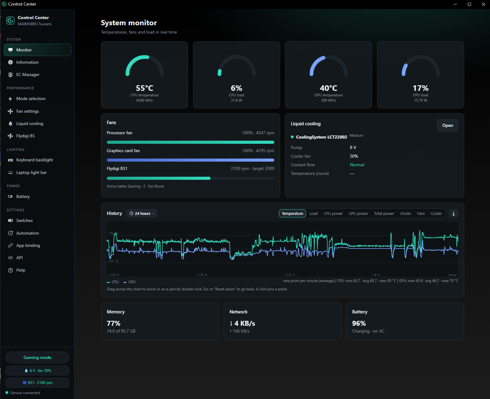
  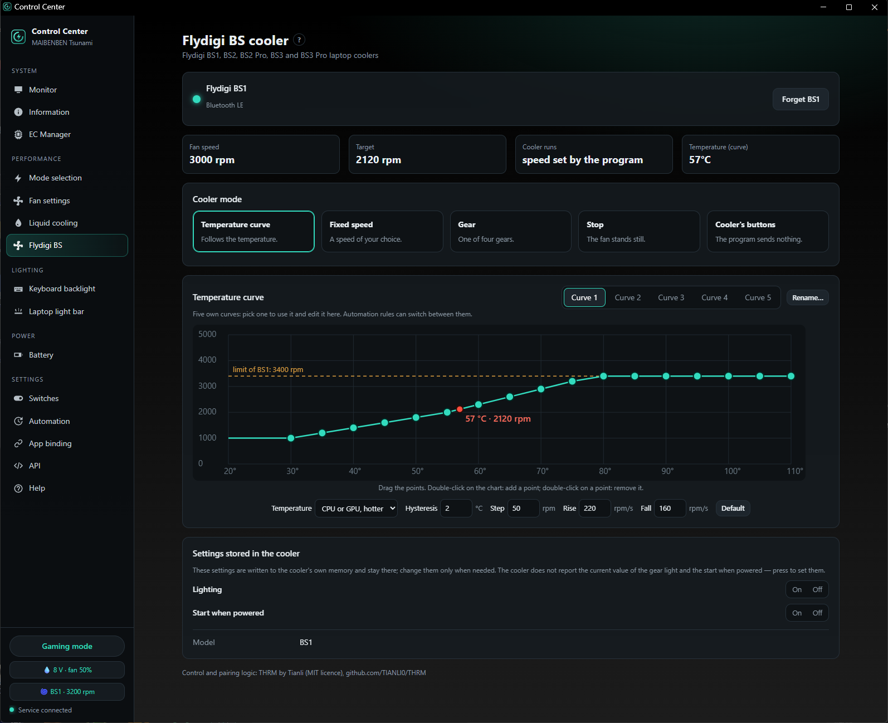
  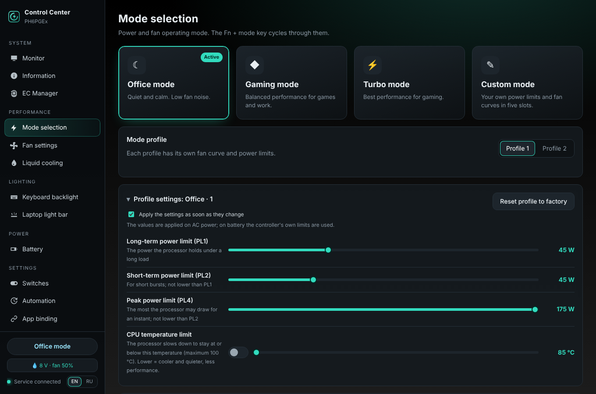
  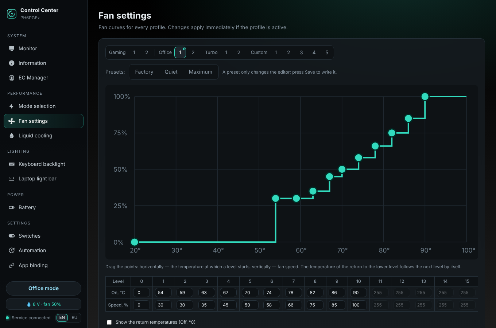
  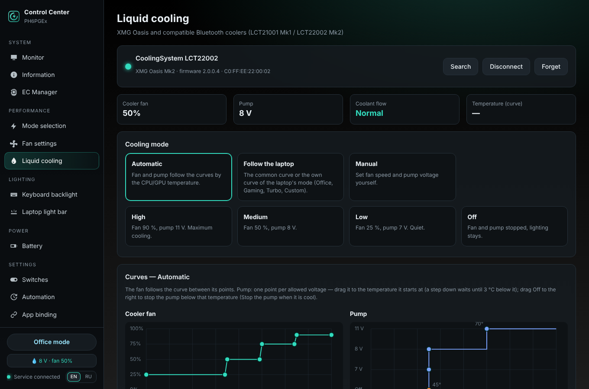
  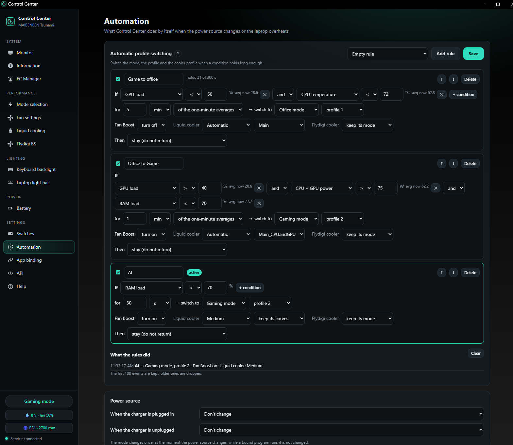
  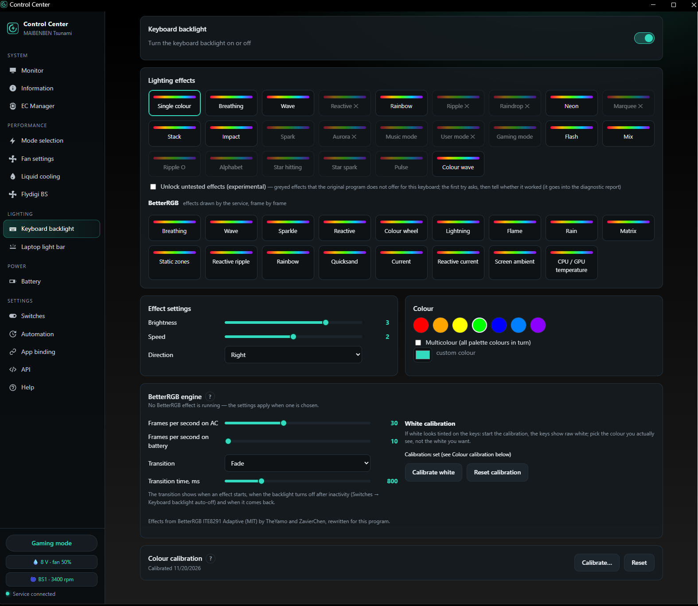
  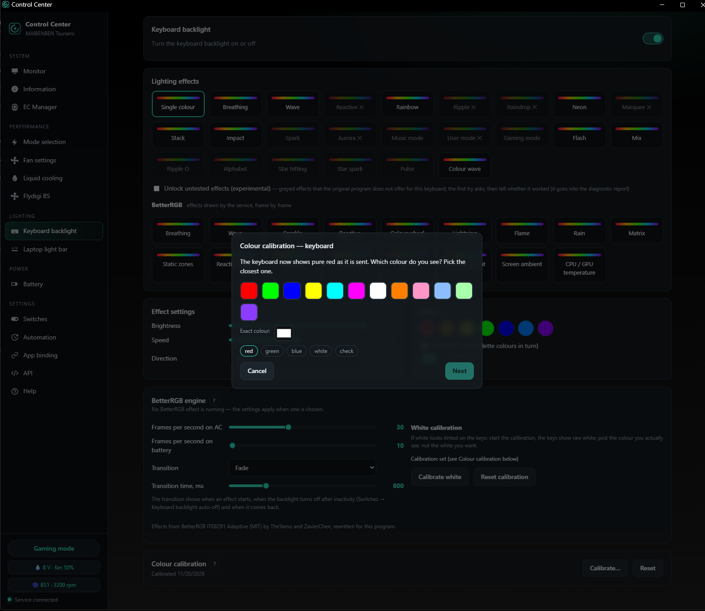
  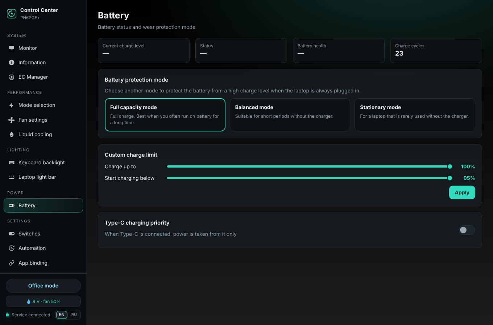
  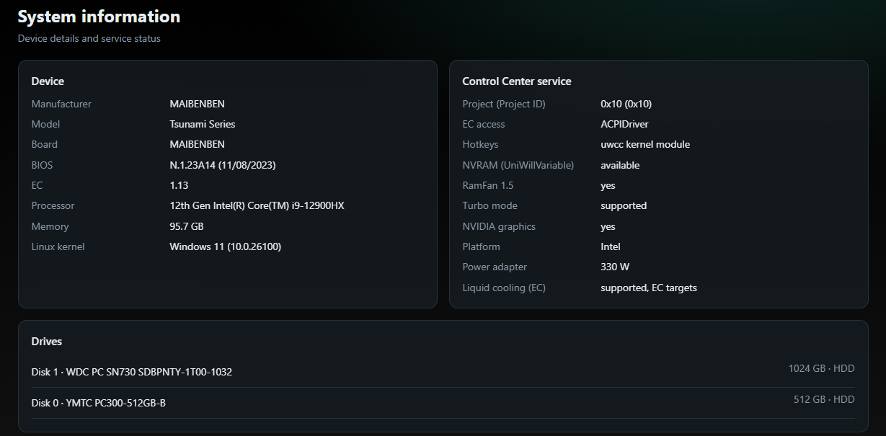
  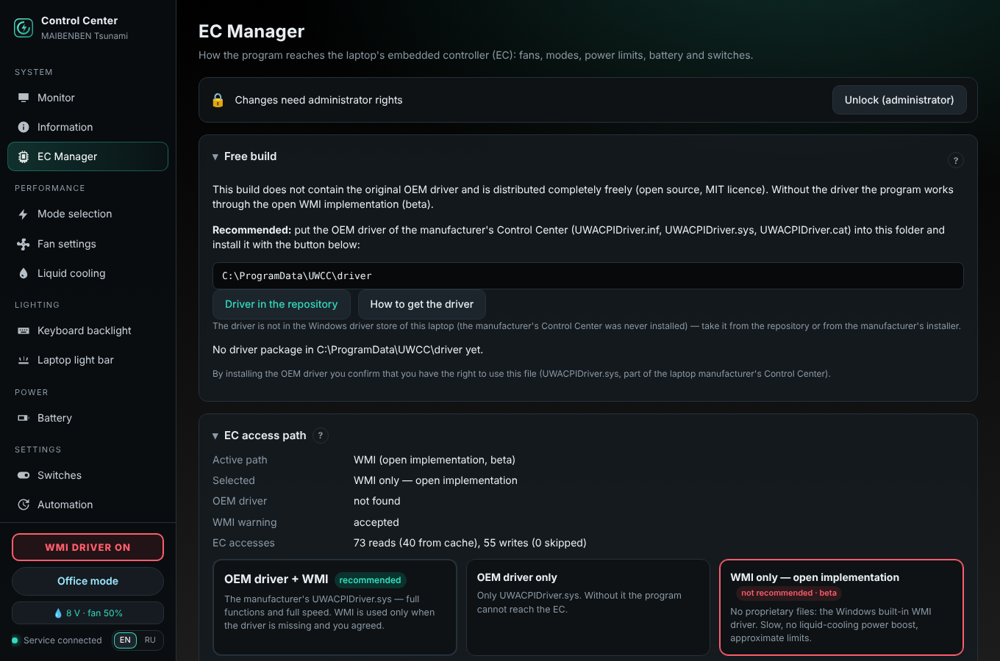
  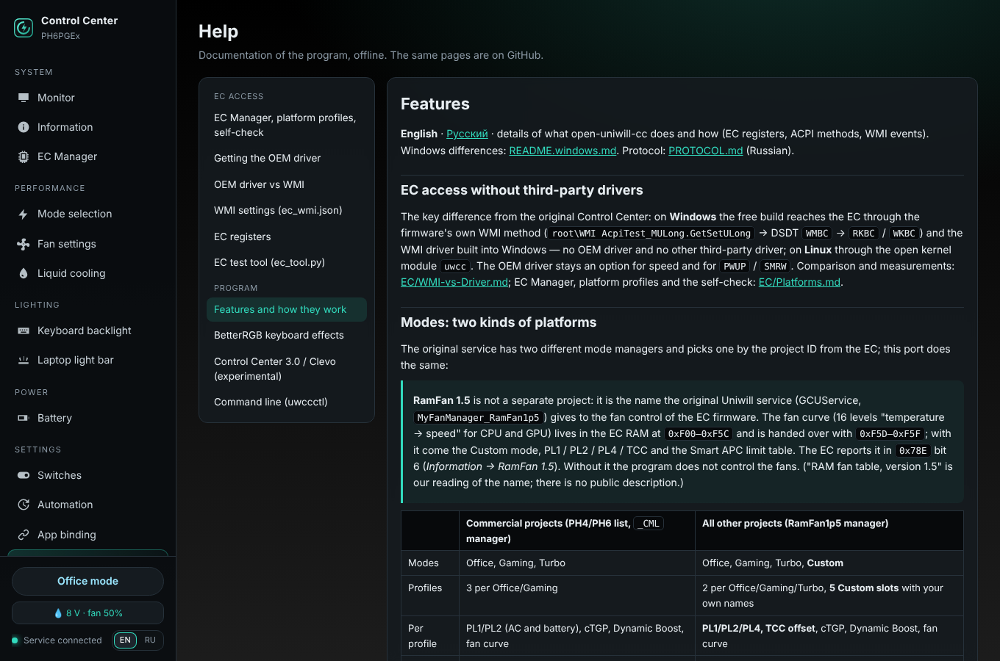
</p>

<sub>截图为英文界面；在程序中可切换为简体中文。</sub>

## 功能

- **Windows 上通过 WMI 开放访问 EC** —— 无需 OEM 驱动或其他第三方驱动（免费版）；或使用 OEM 驱动获得全速。
  **EC 管理器**、平台配置、自检 —— 见[上文](#100--开源无第三方驱动)
- **模式**：办公 / 游戏 / Turbo（在支持的平台上还有带 5 个命名槽位的**自定义**模式）、Fn 模式键、Fan Boost；
  任意模式下的**超级性能**（Turbo 风扇、最大显卡功率），以及 BIOS 支持时的**内存超频**
- **功耗限制** PL1 / PL2 / PL4、NVIDIA cTGP 和 Dynamic Boost —— 在固件报告的范围内
- 按模式 / 配置的**温度上限**：CPU（85–100 °C，可选低至 60 °C）和 NVIDIA GPU 目标温度
- CPU 和 GPU 的**风扇曲线**（16 个点）、预设、恢复出厂
- **键盘灯光**：17 种硬件效果、逐键颜色、游戏分区、软件效果、自动关闭；
  **机身灯条**（后部 / 底座 / 徽标分区）
- **BetterRGB 效果**（1.6.3 新增）：由服务绘制的 16 种效果 —— 雨、矩阵、火焰、闪电、流沙、屏幕氛围、按键涟漪、
  CPU / GPU 温度颜色（1.6.9）…… —— 带过渡、白色校准和顶行指示条（电量、音量、CPU、GPU）：
  [docs/LIGHTING.md](docs/LIGHTING.md)
- **电池**：保护模式、自定义充电上限、USB-C 充电优先
- **开关**：Win 键锁定、Fn 锁定、触摸板、睡眠时 USB 供电、接通电源自动开机、MUX（独显直连）、摄像头
- **监控**：温度、负载、频率、风扇、CPU 和 GPU 功耗、内存、硬盘、电池；一小时历史，可导出为 CSV / JSON / PNG
- **自动化**：按电源切换模式、过热提醒（可选开启 Fan Boost）、应用 → 模式绑定、按功耗 / 温度 / 负载自动切换配置
  （1.6.8）
- **Control Center 3.0 / Clevo**（1.6.6 新增，实验性，独立模块）：搭载 Control Center 3.x 的笔记本上的电源模式、
  风扇模式和曲线、键盘颜色和效果 —— [docs/CLEVO.md](docs/CLEVO.md)
- **MSI Afterburner**（1.7.1 新增，实验性，Windows）：每个模式都可以切换 Afterburner 的配置 1–5 ——
  办公模式降压、Turbo 模式超频 —— [docs/AFTERBURNER.md](docs/AFTERBURNER.md)
- **水冷散热器** XMG Oasis（LCT21001 Mk1 / LCT22002 Mk2）、Eluktronics Liquid Pad Pro、PCS Liquid Series、
  TUXEDO Aquaris：风扇和水泵曲线（通用曲线及按笔记本模式的曲线）、散热器配置、灯光、冷却液流量保护、注液循环
- **Flydigi BS 笔记本散热器**（1.9.0.0 新增）BS1、BS2、BS2 Pro、BS3、BS3 Pro，可通过蓝牙 LE 或 USB 找到：
  独立页面、五条自定义温度曲线（1.9.0.0）、固定转速、档位、停止、灯光开关、保存在散热器中的设置、“监控”页面上的
  风扇转速、自动化规则。协议以及控制与配对逻辑移植自 **Tianli 的 [THRM](https://github.com/TIANLI0/THRM)**（MIT）——
  [docs/FEATURES.md](docs/FEATURES.md#flydigi-bs-coolers)
- **英文、俄文和简体中文**界面（1.9.0.0 新增简体中文）；Windows 上带通知的托盘程序；Linux 上的桌面通知
- **备份与迁移**：导出 / 导入风扇曲线（单条或全部）、完整备份、从原厂 Control Center 导入
- **供脚本和集成使用的 API**：127.0.0.1 上的普通 HTTP + JSON，接口稳定（[docs/API.md](docs/API.md)）—— 事件流、
  功能注册表、可开关的服务模块；一个 Zabbix / 监控导出器只需约 40 行
  （[examples/zabbix_exporter.py](examples/zabbix_exporter.py)）。*设置 → API*（默认关闭）：权限为只读或完全的
  独立令牌，并可选择通过 HTTPS 及地址列表从局域网访问
- **可翻译的界面**：内置英文和俄文，其他语言只需一个 JSON 文件（简体中文以 `uwccd/web/lang/zh-cn.json` 提供）——
  [docs/TRANSLATING.md](docs/TRANSLATING.md)
- 基于 GitHub 发布版的**更新检查**（每天一次，可关闭）；Windows 上可在窗口或托盘中下载、校验并安装；
  针对特定笔记本的可选*中间*更新 —— [版本与更新](#版本与更新)
- 用于问题反馈和新机型的**诊断报告**（可选择隐私信息，可通过 GitHub 或电子邮件发送）
- 两个系统上都有 **`uwccctl`** 命令行工具
- **内置帮助**：程序内的本文档，离线可用，英文和俄文（*帮助*）

完整功能列表及每项功能对应的 EC 寄存器：[docs/FEATURES.md](docs/FEATURES.md)。

## 支持的笔记本

**Control Center 版本。** 本服务移植自 Uniwill Control Center **5.52.x** 中的官方服务 GCUService 1.0.2.70
（已与 5.52.49.6、MBB 版核对）。它取代该版本的 Control Center：

| 厂商的 Control Center | 状态 |
|---|---|
| 5.52.x（服务 GCUService 1.0.2.x） | **支持** —— 本程序由其移植 |
| 5.56.x，带较新的 1.2 版服务（如机械革命 5.56.60.12） | 可运行（相同的 EC 布局，RamFan 1.5），**未测试** —— 其代码受保护，未从中获取任何内容 |
| 用于 Clevo 和同方的 3.x（Microsoft Store 应用） | 自 1.6.6 起**实验性**支持 —— *Control Center 3.0 / Clevo* 模块（DCHU 接口），自 1.7.0 起使用常规页面；来自同方笔记本的报告确认全部功能可用：[docs/CLEVO.md](docs/CLEVO.md) |
| Leishen ControlCenter 3.x（雷神 Thunderobot，由广达制造） | 自 1.6.12 起**实验性**支持 —— *Leishen / Thunderobot* 模块（WMI 块 `RW_GMWMI`），自 1.7.0 起使用常规页面；已在雷神 R16 上检查：[docs/LEISHEN.md](docs/LEISHEN.md) |
| 其他厂商的控制中心（如机械革命自己的 3.x） | **不支持** —— 未移植，未测试 |

**理论上的平台列表。** 程序从 EC 读取**项目 ID**（`0x740`）并识别以下项目；`0x10` 和 `0x1A` 已在真实硬件上检查。
支持级别显示在窗口中（*信息*）：

| 系列 | 项目 ID | 项目 / 笔记本 | 级别 |
|---|---|---|---|
| — | `0x10` | MAIBENBEN Tsunami X629、机械革命蛟龙 16 Super（Mechrevo Questyle 16 Super）、XMG NEO 16（E23） | **已测试** |
| PHxT | `0x12`–`0x16` | PH4TRX1、PH4TUX1、PH4TQx1、PH6TRX1、PH6TQxx | 已知 |
| PHxA | `0x17`、`0x1701`–`0x1707` | PH4ARxx、PH4AUxx、PH4AXxx、PH6AQxx、PH6ARxx、PH6AGxx、PH4AUxf | 已知 |
| PHxP | `0x18`、`0x1801`–`0x180D` | PH4PRxx、PH4PUxx、PH4PGx1、PH4PGx2、PH6PRxx、PH6PGEx、PH6PG0x、PH6PG3x、PH6PG7x（亦有 150 W）、PH4AQE3 | 已知 |
| 服务 1.2 | `0x1A` | 机械革命耀世（X6AR55xY）、机械革命旷世 / 极光 B2（极光 X / Aurora X）、XMG NEO 16（E25） | **已测试**（用户报告，Linux 和 Windows，见下文） |
| 任何其他带 RamFan 1.5 的 Uniwill 项目 | — | | 实验性 |

*已测试* —— 用本程序检查过；*已知* —— 在官方服务的平台表中，但未在此检查；*实验性* —— 不在这些表中。风扇控制需要
RamFan 1.5（若 EC 未报告，窗口会给出警告）。在 WMI 路径上，只有拥有配置的平台才能使用这些功能；其他平台请使用
OEM 驱动，或通过[自检](docs/EC/Platforms.md)生成配置。

这些模具以许多品牌出售（MAIBENBEN、XMG/Schenker、Eluktronics、机械革命、雷神……）。运行 `uwccctl status` ——
第一行显示项目。搭载 Control Center 3.x 的 Clevo 和同方笔记本（如同方 GK/GM 准系统，其 EC 与 Uniwill 不同）：
仅支持实验性的 *Control Center 3.0 / Clevo* 模块（[docs/CLEVO.md](docs/CLEVO.md)）。

**已测试机型**

| 笔记本 | CPU / GPU | 项目 | BIOS / EC | Linux | Windows |
|---|---|---|---|---|---|
| MAIBENBEN Tsunami 系列 | i9-12900HX / NVIDIA | `0x10` | N.1.23A14 / 1.13 | ✅ Ubuntu 24.04 | ✅ Windows 11 24H2 |
| 机械革命 Aurora X（旷世 / 极光 B2）—— 用户报告 | i7-13700HX / RTX 5060 | `0x1A` | N.1.25MRO33 / 1.31 | ✅ CachyOS，内核 7.3（内核模块 `uwcc`）：模式、功耗限制、监控；自 1.8.2.1 起支持自定义风扇曲线（EC 需要自定义模式标志 `CUME` + `UFME`）；自 1.8.1.1 起支持单区 RGB 键盘背光（EC，颜色 + 5 级）和显卡风扇转速；自 1.8.2.2 起保持电池保护（等待确认） | ✅ Windows 11（OEM 驱动）：模式、风扇、限制、监控；自 1.6.4 起支持单色背光；BIOS 变量相关功能尚未支持 |
| 机械革命耀世（X6AR55xY）—— 用户报告 | Core Ultra 9 275HX / RTX 5080、RTX 5070 Ti | `0x1A` | N.1.18MRO24 / 1.25、N.1.13MRO16 / 2.6 | ✅ Ubuntu 26.04（内核模块 `uwcc`）：模式、Fan Boost、风扇表、来自固件表 `SMRW` 的功耗限制（自 1.7.3 起）、cTGP / Dynamic Boost、电池、开关、水冷散热器 LCT22002、逐键 RGB 键盘和灯条 | ✅ Windows 10（OEM 驱动）：自检第 2 阶段全部正常（模式、Fan Boost、限制、cTGP、电池、风扇表）、水冷散热器 LCT22002；自 1.6.7 起支持逐键 RGB 键盘 ITE `600B` |
| XMG NEO 16（E25）—— 用户报告 | Core Ultra 9 275HX / NVIDIA | `0x1A` | N.1.33A27 / 2.11 | — | ✅ Windows 11（OEM 驱动）：自 1.6.7 起支持逐键 RGB 键盘 ITE `600B`；前部灯条 ITE `7001` 自 1.8.2.4 起使用其自有协议工作（1.9.0.0 在 Windows 上完全确认；使用 `7000` 命令时不亮） |

测试过您的笔记本？请提交一份[机型报告](https://github.com/aspidovss/open-uniwill-cc/issues/new?template=model_report.yml)。

**您的笔记本不受支持或某些功能无法工作？** 请创建诊断报告：*信息 → 诊断报告 → 创建报告*（或 `uwccctl report`）。
它会收集添加平台所需的全部内容 —— EC 寄存器、BIOS 设置、带平台配置草稿的自检第 1 阶段（只读）、键盘 / 灯条设备、
NVIDIA 限制、日志 —— 不包含序列号、MAC 地址或用户名（如有需要可单独勾选）。请将 zip 附加到 issue 或发送至
**OUCC@aspidov.ru**。

## 下载

在 [Releases](https://github.com/aspidovss/open-uniwill-cc/releases) 中下载：

| 文件 | 用途 |
|---|---|
| `open-uniwill-cc-windows-<ver>-setup.exe` | Windows 10/11 x64 —— 安装程序，**非免费版**：OEM 驱动 + WMI |
| `open-uniwill-cc-windows-<ver>-portable.zip` | Windows —— 同上，用 `install.ps1` 安装 |
| `open-uniwill-cc-windows-<ver>-free-setup.exe` | Windows —— **免费版**：仅 WMI，不含 OEM 驱动或其他专有文件，完全自由分发 |
| `open-uniwill-cc-windows-<ver>-free-portable.zip` | Windows —— 免费版，用 `install.ps1` 安装 |
| `open-uniwill-cc-linux-<ver>.tar.gz` | Ubuntu / 基于 Debian 的 Linux（安装程序使用 apt；在 Ubuntu 24.04 上开发） |
| `SHA256SUMS.txt` | 校验和 |

## 版本与更新

### 版本号

自 1.7.5.0 起，版本号由四个数字组成 —— `主版本.功能.修复.平台`，例如 `1.7.6.2`：

| 数字 | 何时变化 | 示例 | 是否应安装？ |
|---|---|---|---|
| 第 1 位 —— 主版本 | 程序的工作方式发生根本变化 | `1.9.3.0` → `2.0.0.0` | 是，请先阅读发布说明 |
| 第 2 位 —— 功能 | 新增或更改功能 | `1.7.6.0` → `1.8.0.0` | 是 |
| 第 3 位 —— 修复 | 修复功能 | `1.7.6.0` → `1.7.7.0` | 是 |
| 第 4 位 —— 平台 | 仅特定笔记本的设置变化：平台配置、表格、限制 | `1.7.6.0` → `1.7.6.1` | 仅当发布说明提到您的笔记本时 |

- 某一位数字增加时，其后的数字归零：`1.7.6.3` → `1.7.7.0`。
- 缺少第 4 位即为 0：`1.7.5` 等同于 `1.7.5.0`。
- 标签和发布标题就是版本号：标签 `v1.7.6.0`，发布 *1.7.6.0*。
- 每个发布版都是完整的。您可以在现有版本上直接安装任何更新的版本，无需安装中间版本（`1.7.6.0` → `1.7.7.0` 跳过
  `1.7.6.1`、`1.7.6.2`……但仍包含它们的内容）。
- Linux 上的内核模块 `uwcc` 有自己的 DKMS 版本（如 1.7.3）。只有模块本身变化时它才会变，因此程序更新不一定会重新编译它。

### 更新检查

服务每天一次（以及在*信息 → 关于 → 检查更新*时）向 GitHub 查询最新发布版。只请求
`https://api.github.com/repos/aspidovss/open-uniwill-cc/releases/latest`，带普通的 User-Agent，不发送其他任何内容。
*自动检查更新*（*开关*）可关闭每日检查。

| 最新发布版变化了 | 您会看到 |
|---|---|
| 第 1、2 或 3 位数字 | **更新**：一次通知，*信息*页面显示*版本 X 可用*，托盘中显示*安装更新 X* |
| 仅第 4 位数字 | **中间更新**，标记为可选：*中间更新 X：仅包含特定笔记本的设置，可以跳过* |
| 没有更新的版本 | *您使用的是最新版本* |

**检查中间更新**（位于*开关*中*自动检查更新*之下，也在*信息 → 关于*中；默认开启）：关闭后完全不再提供中间更新 ——
没有通知，没有托盘项；卡片中只显示*不提供中间更新 X*。改变前三位数字之一的更新始终会显示。该开关立即生效，无需重新检查。

**安装。** 在 Windows 上，*下载并安装*（窗口或托盘）会将该发布版的安装程序下载到“下载”文件夹，用同一发布版的
`SHA256SUMS.txt` 校验后启动。在 Linux 上，请从发布页面下载压缩包，并在其中运行 `sudo bash install.sh`
（见[安装](#安装)）。

> 1.7.4 及更早的版本只比较前三位数字，因此完全不显示中间更新；下一个修复或功能发布版会照常推送给它们。

## 安装

### Windows

1. 运行 `open-uniwill-cc-windows-<ver>-setup.exe`，保持勾选 **“Disable the original Control Center service”**
   （两个程序不能同时控制同一个 EC）。
2. 选择程序访问嵌入式控制器的方式：**OEM 驱动 + WMI**（默认，推荐）、**仅 OEM 驱动**，或**仅 WMI** —— 不含专有文件的
   开源实现（不推荐，测试版：较慢，没有水冷功率提升；仅在 MAIBENBEN Tsunami X629 / 机械革命蛟龙 16 Super /
   XMG NEO 16（E23）上测试过）。之后可在 **EC 管理器**中更改。见 [docs/EC](docs/EC/README.md)。
3. 图标会出现在通知区域。程序**随 Windows 启动并隐藏在托盘中**；单击图标（或*开始 → OUCC*）打开窗口。
4. **更新：**在旧版本上直接运行新的安装程序 —— 它会找到并替换旧版本（包括用 `install.ps1` 安装的版本，以及 1.8.2.6
   之前名为 *UWCC Control Center* 时的 `UWCC Control Center` 文件夹）；设置会保留。自 1.8.2.6 起，程序名为
   **OUCC**（Open Uniwill Control Center），安装在 `C:\Program Files\OUCC`。

**免费版**（`-free-setup.exe`）：不包含原厂 OEM 驱动，完全自由分发。没有驱动时通过 WMI（测试版）工作。推荐：将厂商
Control Center 中的 OEM 驱动（`UWACPIDriver.inf`、`.sys`、`.cat`）放入 `C:\ProgramData\UWCC\driver` —— 安装程序会从
那里安装，或稍后使用 *EC 管理器 → 安装 OEM 驱动*（`uwccctl ec install-driver`）。安装即表示您确认有权使用该文件。

#### 从哪里获取 OEM 驱动

该驱动**不是 MIT 许可** —— 仅在您有权使用时使用（例如您的笔记本出厂时附带厂商的 Control Center）。非免费版已包含它。
对于免费版：

1. **从本机一键获取：***EC 管理器 → 从本系统获取驱动* —— 将 Windows 驱动存储中的驱动（如果曾安装过厂商的
   Control Center）复制到 `C:\ProgramData\UWCC\driver`（`uwccctl ec fetch-driver`）。
2. **从本仓库获取：**[`proprietary/driver`](https://github.com/aspidovss/open-uniwill-cc/tree/main/proprietary/driver)
   （来自 Control Center 5.52.49.6 的 17.53.43.609，未修改）→ `C:\ProgramData\UWCC\driver`。
3. **手动获取**（驱动存储、用 innoextract 解包厂商安装程序）：[docs/EC/OEM-driver.md](docs/EC/OEM-driver.md)，
   程序中也有：*帮助 → 获取 OEM 驱动*。

然后使用 *EC 管理器 → 安装 OEM 驱动*（`uwccctl ec install-driver`）。驱动包会先经过检查 —— 文件、针对
`ACPI\INOU0000` 的 INF、签名、已知版本；未知版本或签名问题需要勾选*我仍要使用此驱动并了解风险*（`--accept-risks`）。

便携版 zip：解压后在 PowerShell 中运行 `powershell -ExecutionPolicy Bypass -File .\install.ps1`（会请求管理员权限）。

安装内容：`uwccd` 服务（LocalSystem）、`ControlCenter.exe`（托盘 / 窗口）、`uwccctl.exe`（控制台），以及 —— 仅非免费版 ——
尚未安装时的 OEM ACPI 驱动 `UWACPIDriver`（选择*仅 WMI* 时不安装）。免费版不安装任何驱动。
详情：[README.windows.md](README.windows.md)。

### Linux

```bash
tar xzf open-uniwill-cc-linux-<ver>.tar.gz
cd open-uniwill-cc-<ver>
sudo bash install.sh
```

安装程序会显示[用户协议](uwccd/web/eula.en.txt)并要求您接受（无人值守安装使用 `--accept-agreement`）。然后注销并
重新登录（您的用户会加入 `uwcc` 组），从菜单启动 **Control Center** 或运行 `uwcc`。安装程序会用 DKMS 编译 `uwcc`
内核模块（无法加载时回退到 `acpi_call`）。

**安全启动（Secure Boot）：**如果 `modprobe uwcc` 提示 *Key was rejected*，请运行
`sudo mokutil --import /var/lib/shim-signed/mok/MOK.der`，重启并选择 *Enroll MOK*。
**TUXEDO Control Center** 控制的是同一个 EC —— 安装程序会停止 `tccd`；请勿同时运行两者。

## 使用

- **窗口** —— 所有设置；首次启动时会询问界面语言，之后可随时在*开关 → 界面语言*中更改。
- **托盘（Windows）** —— 右键单击：模式、Fan Boost、键盘背光、水冷散热器、语言、更新、*随 Windows 启动*。
- **托盘（Linux）** —— *显示配置窗口*和*关闭窗口（释放内存）*；需要 `gir1.2-ayatanaappindicator3-0.1`
  （安装程序会添加）以及能显示 AppIndicator 图标的桌面（Ubuntu 可以）。
- **窗口只在打开时占用内存。** ✕ 会完全关闭它（Windows 上约 150–200 MB —— 应用模式的 Edge —— Linux 上更少）；
  服务和托盘继续工作，*打开*约一秒即可重新启动窗口。窗口只有一个：*打开*会将其置于前台。托盘中的*关闭窗口*与 ✕ 相同。
- **控制台**（Linux 上为 `uwccctl`，Windows 上为 `uwccctl.exe`）：

```text
uwccctl status                   模式、风扇、温度、电池、散热器
uwccctl monitor --watch 2        每 2 秒显示传感器
uwccctl mode office|gaming|turbo|custom
uwccctl profile set custom:0 pl1=65 pl2=90 tcc=10 name=Quiet
uwccctl fan set current cpu 0/45:0 55/50:30 70/65:60 85/80:100
uwccctl boost on|off  /  super on|off  /  ramoc on|off
uwccctl battery limit 80 60      充电上限
uwccctl kb effect wave --speed 3 --multi
uwccctl set fn_lock on           任意开关或自动化设置（uwccctl get 会列出）
uwccctl apps add steam gaming    某程序运行时的模式
uwccctl lc curve common fan 40:25 70:60 90:100   水冷散热器风扇曲线
uwccctl flydigi slot 2 Games     Flydigi BS：切换到曲线 2 并命名
uwccctl lang zh-cn               界面语言
uwccctl export all backup.json   将风扇曲线、配置和设置导出到文件
uwccctl report                   诊断报告（zip），用于问题反馈和新机型
uwccctl --json status            任何命令都可输出 JSON，供脚本使用
```

窗口能更改的一切都可以在控制台中完成。完整参考：[docs/CLI.md](docs/CLI.md)，Linux 上的 `man uwccctl`
（也安装了 bash 补全），两个系统上都可用 `uwccctl help COMMAND`。

## 卸载 / 恢复原厂软件

- **Windows：***设置 → 应用 → OUCC → 卸载*（也适用于用 `install.ps1` 安装的版本）。风扇控制会交还给 EC，原厂的
  `GCUService` 会被重新启用。
- **Linux：**`sudo bash uninstall.sh`（`--purge` 还会删除 `/var/lib/uwcc` 中的设置）。

## 安全

- 只写入原厂服务写入的 EC 寄存器，写入方式也相同。如果 EC 未报告 RamFan 1.5，模式和风扇曲线保持禁用。
- 风扇曲线和散热器曲线在写入前会经过校验；有风险的设置会要求确认。
- UEFI 变量 `UniWillVariable` 只有在其布局经过验证后才会写入。
- 服务只监听 `127.0.0.1`，并需要本地用户 / `uwcc` 组可读的令牌。见 [SECURITY.md](SECURITY.md)。

## 故障排除、构建、调试

[docs/STRUCTURE.md](docs/STRUCTURE.md) —— 项目的组织方式：服务、客户端、每个模块。

[docs/BUILD.md](docs/BUILD.md) —— 构建 Linux 和 Windows 安装包、在没有硬件的情况下运行（`--mock`）、调试日志、
日志位置、问题反馈时应附带的内容。

## 联系方式

- 问题、疑问、新机型：[GitHub issues](https://github.com/aspidovss/open-uniwill-cc/issues)
- 电子邮件：**OUCC@aspidov.ru**（也用于安全报告，见 [SECURITY.md](SECURITY.md)）

## 贡献者

感谢所有贡献代码的人 —— [CONTRIBUTORS.md](CONTRIBUTORS.md)、
[GitHub contributors](https://github.com/aspidovss/open-uniwill-cc/graphs/contributors)。

**特别感谢每一位发送报告的用户**：大多数新笔记本之所以得到支持，是因为有人测试了某个版本并反馈了结果。如果您希望
作为测试者被列出，请在项目的讨论帖中留言或提交 [issue](https://github.com/aspidovss/open-uniwill-cc/issues) ——
名字只会应要求添加。

## 许可证

MIT —— 见 [LICENSE](LICENSE)，**但** `kernel/`（GPL-2.0）以及 `proprietary/` 和 `uwccd/lighting/oem/`（OEM 文件和源自
OEM 的代码，所有权利归其所有者，为互操作性而包含）**除外**。
BetterRGB 键盘效果（`uwccd/lighting/fx.py`）改写自 ZavierChen 的
[BetterRGB ITE8291 Adaptive](https://github.com/ZavierChen/BetterRGB-ITE8291-Adaptive) 和 TheYamo 的
[Better RGB](https://github.com/EpicYamo/Better-RGB-for-Tongfang-ITE8291) —— 同样为 MIT；其版权声明保留在
[LICENSE](LICENSE) 和 [THIRD_PARTY_LICENSES.txt](THIRD_PARTY_LICENSES.txt) 中。
Flydigi BS 散热器支持（`uwccd/flydigi/`）是 Tianli 的 [THRM](https://github.com/TIANLI0/THRM) 从 Go 到 Python 的
移植 —— 协议以及控制与配对逻辑保持不变 —— MIT，Copyright (c) 2025 Tianli；该声明保留在 [LICENSE](LICENSE) 和
[THIRD_PARTY_LICENSES.txt](THIRD_PARTY_LICENSES.txt) 中。
致谢及提供帮助的项目：[NOTICE.md](NOTICE.md)，贡献者：[CONTRIBUTORS.md](CONTRIBUTORS.md)。

**用户协议**（[English](uwccd/web/eula.en.txt) · [Русский](uwccd/web/eula.ru.txt)）—— 在安装程序中以及首次打开窗口
时显示：本程序按*原样*提供，使用责任由您承担，并且您确认可以使用随附的 OEM 组件或自行替换它们。用户协议目前只有英文
和俄文版本。
