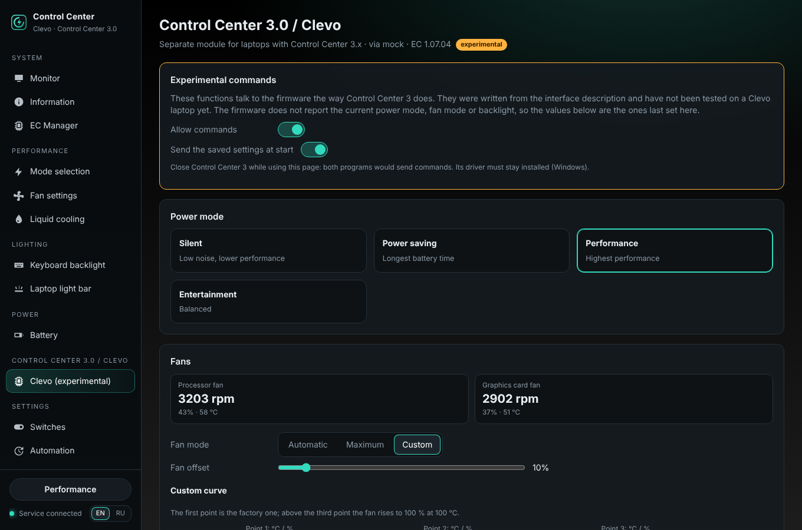

# Control Center 3.0 / Clevo (experimental)

**English** · [Русский](CLEVO.ru.md)

Since 1.6.6 the program has a **separate, experimental module** for laptops that come with **Control Center 3.x**
(Clevo chassis and the brands that sell them; Control Center 3 is the Microsoft Store app by Clevo). These laptops
have no Uniwill EC interface: they are driven through Clevo **DCHU** commands. The module lives in `uwccd/clevo/` and
has its own page in the window — *Control Center 3.0 / Clevo → Clevo (experimental)* — and its own command,
`uwccctl clevo`. It does not change anything on Uniwill laptops.

> **Not tested on a Clevo laptop yet.** The commands were written from the interface description (see *Sources*).
> Commands that change something are **off** until you allow them. A diagnostic report from a Clevo laptop
> (*Information → Diagnostic report*, section *Control Center 3.0 / Clevo*) helps to test the module.



## How the program reaches the firmware

All functions are calls of one ACPI method: `_DSM` with UUID `93f224e4-fbdc-4bbf-add6-db71bdc0afad` of the ACPI
device `CLV0001`. The function number is the command and the argument is a buffer. Older firmware has a WMI method
`ABBC0F6D-8EA1-11D1-00A0-C90629100000` instead.

| | How | What must be installed |
|---|---|---|
| Windows | the driver of Control Center 3 (device interface `{86994C74-AD43-4812-B7E7-0C420B5C5FD7}`, IOCTL `0x322400`), opened directly by the service — no vendor DLL | the Clevo / OEM driver package that Control Center 3 needs. The Control Center 3 app itself may stay installed, but **close it** while you use this page |
| Linux | our kernel module `uwcc` (ioctl `UWCC_IOC_CLEVO`); it is loaded on Clevo laptops too | `install.sh` with the module (DKMS), as on Uniwill laptops |

The program finds the interface at start. If there is a Clevo interface and no Uniwill EC, the service runs in
**Clevo-only** mode: the Uniwill pages (modes, fan tables, battery…) do not work, and a banner leads to the Clevo
page. Monitoring of the operating system (temperatures, load, memory…) works as usual.

## Functions

| Function | Command | Notes |
|---|---|---|
| Capabilities | `0x10`, `0x46`, `0x52`, `0x60`, `0x7A` | read at start; the page shows only what the firmware reports |
| Fans: speed, duty, temperature | `0x0C` | CPU, GPU, second GPU fan; read every 2 s while the page is open |
| Factory fan curves, fan count, Max-Q | `0x0D` | read at start |
| Power mode: Silent / Power saving / Performance / Entertainment | `0x79`, option `0x19` | |
| Fan mode: Automatic / Maximum / Max-Q / Custom | `0x79`, option `0x01` | Max-Q only when the firmware starts in it |
| Fan offset 0–100 % | `0x79`, option `0x0E` | when supported |
| Custom fan curve: three points per fan | `0x0E` (256-byte table), then mode Custom | the first point stays the factory one; above the third point the fan rises to 100 % at 100 °C |
| Factory fan curve | `0x79`, option `0x22` | |
| Anti-dust cycle | `0x79`, option `0x29` | when supported |
| Keyboard backlight on / off | `0x67`, `E0` | |
| Colour (whole keyboard or zone 0–3) | `0x67`, `F0`–`F3` | |
| Brightness 0–255 | `0x67`, `F4` | |
| Firmware effects: Random, Breathing, Cycle, Wave, Dance, Tempo, Flashing | `0x67` | |
| Backlight sleep timer | `0x79`, option `0x18` | |
| Colour cycle at power-on | `0x79`, option `0x1E` | |
| EC version | `0x04` (query) | shown on the page and in the report |

**What the firmware does not tell.** It does not report the current power mode, fan mode or backlight; Control
Center 3 keeps them itself. So does this module (setting `clevo_state`): the page shows the values last set here, and
with *Send the saved settings at start* (`clevo_restore`, on by default) they are sent again when the service starts.

Per-key RGB keyboards of Clevo laptops are usually ITE controllers on USB; the normal *Keyboard backlight* page
(and BetterRGB) may already work with them — a report tells.

## Allowing commands

On the page: *Experimental commands → Allow commands*. Or:

```bash
uwccctl clevo writes on
```

Until then, every command answers *"Control Center 3.0 / Clevo commands are off"*; reading always works.

## Command line

```bash
uwccctl clevo                                   # interface, capabilities, fans, saved state
uwccctl clevo power performance                 # quiet | powersave | performance | entertainment
uwccctl clevo fan auto                          # auto | max | maxq | custom
uwccctl clevo fan offset 20
uwccctl clevo fan curve cpu 30,0 55,40 75,80    # first point = factory, then Custom mode
uwccctl clevo fan defaults
uwccctl clevo antidust
uwccctl clevo kb color FF2000                   # [ZONE 0-3]
uwccctl clevo kb brightness 180                 # 0-255
uwccctl clevo kb effect wave
uwccctl clevo kb sleep 60                       # 0 = never
uwccctl clevo kb boot-effect off
uwccctl clevo restore off
```

API: `GET /api/clevo`, `POST /api/clevo {"action": "power_mode", "mode": "quiet"}` (actions: `power_mode`,
`fan_mode`, `fan_offset`, `curve`, `fan_defaults`, `anti_dust`, `kb_power`, `kb_color`, `kb_brightness`,
`kb_effect`, `kb_sleep`, `boot_effect`); settings `clevo_writes`, `clevo_restore`.

## Diagnostics

The general diagnostic report (*Information → Diagnostic report*, `uwccctl report`) has the section
*Control Center 3.0 / Clevo*, **on by default and collected on every laptop** — also when the module finds nothing,
so the report shows why. It only reads:

| | |
|---|---|
| module | interface and path, capability words, raw fan buffers `0x0C` / `0x0D`, fans, factory curves, EC version, the settings saved here |
| system | DMI vendor / model / board / BIOS |
| Windows | Control Center 3 Store packages, ACPI `CLV0001` and Clevo / Insyde devices and drivers, services, `root\WMI` classes `CLEVO_*`, the Control Center 3 driver interface |
| Linux | `CLV0001` in sysfs, WMI devices `ABBC0F6x`, loaded modules (`uwcc`, `clevo_acpi`, `clevo_wmi`, `tuxedo_*`), `/dev/uwcc` |

`report.txt` gets one line with the result, e.g. *"not found (…): ACPI CLV0001 present, but the uwcc module is not
loaded"*, and the summary at the top has `clevo`.

## Not supported (yet)

GPU / CPU overclocking, Flexikey, the light bar and logo colour of some models, battery utility, the anti-dust
schedule, per-key RGB through DCHU. The capability words in the report show which of these a laptop has.

## Sources

- The interface of the Control Center 3 driver (device interface, IOCTL, request layout) was analysed for
  interoperability from the driver's user-mode library; **no vendor code or files are used or shipped**.
- Command numbers and their arguments match the open TUXEDO drivers `clevo_acpi` / `clevo_wmi` (GPL) and what
  Control Center 3 sends.
- [CustomClevoController](https://github.com/omerboran63/CustomClevoController) (no licence) was looked at as a list of
  features; nothing was taken from it.
