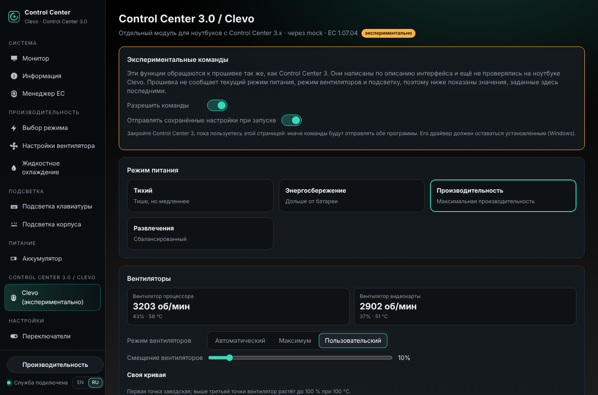

# Control Center 3.0 / Clevo (экспериментально)

[English](CLEVO.md) · **Русский**

С версии 1.6.6 в программе есть **отдельный экспериментальный модуль** для ноутбуков с **Control Center 3.x** (шасси
Clevo и бренды, которые их продают; Control Center 3 — приложение Clevo из Microsoft Store). У этих ноутбуков нет
интерфейса EC Uniwill: ими управляют командами Clevo **DCHU**. Модуль находится в `uwccd/clevo/`, у него своя
страница в окне — *Control Center 3.0 / Clevo → Clevo (экспериментально)* — и своя команда `uwccctl clevo`. На
ноутбуках Uniwill он ничего не меняет.

> **На ноутбуке Clevo ещё не проверялся.** Команды написаны по описанию интерфейса (см. *Источники*). Команды,
> которые что-то меняют, **выключены**, пока вы их не разрешите. Диагностический отчёт с ноутбука Clevo
> (*Информация → Диагностический отчёт*, раздел *Control Center 3.0 / Clevo*) поможет проверить модуль.



## Как программа обращается к прошивке

Все функции — это вызовы одного метода ACPI: `_DSM` с UUID `93f224e4-fbdc-4bbf-add6-db71bdc0afad` устройства ACPI
`CLV0001`. Номер функции — команда, аргумент — буфер. В старых прошивках вместо него метод WMI
`ABBC0F6D-8EA1-11D1-00A0-C90629100000`.

| | Как | Что должно быть установлено |
|---|---|---|
| Windows | драйвер Control Center 3 (интерфейс устройства `{86994C74-AD43-4812-B7E7-0C420B5C5FD7}`, IOCTL `0x322400`), служба открывает его сама — без DLL производителя | пакет драйверов Clevo / производителя, который нужен Control Center 3. Само приложение Control Center 3 можно не удалять, но **закройте его**, пока пользуетесь этой страницей |
| Linux | наш модуль ядра `uwcc` (ioctl `UWCC_IOC_CLEVO`); он загружается и на ноутбуках Clevo | `install.sh` с модулем (DKMS), как на ноутбуках Uniwill |

Программа находит интерфейс при запуске. Если есть интерфейс Clevo и нет EC Uniwill, служба работает в режиме
**«только Clevo»**: страницы Uniwill (режимы, таблицы вентиляторов, батарея…) не работают, баннер ведёт на страницу
Clevo. Мониторинг операционной системы (температуры, загрузка, память…) работает как обычно.

## Функции

| Функция | Команда | Примечания |
|---|---|---|
| Возможности | `0x10`, `0x46`, `0x52`, `0x60`, `0x7A` | читаются при запуске; на странице только то, что сообщает прошивка |
| Вентиляторы: обороты, скважность, температура | `0x0C` | ЦП, ГП, второй вентилятор ГП; каждые 2 с, пока страница открыта |
| Заводские кривые, число вентиляторов, Max-Q | `0x0D` | читаются при запуске |
| Режим питания: Тихий / Энергосбережение / Производительность / Развлечения | `0x79`, опция `0x19` | |
| Режим вентиляторов: Автоматический / Максимум / Max-Q / Пользовательский | `0x79`, опция `0x01` | Max-Q — только если прошивка в нём стартует |
| Смещение вентиляторов 0–100 % | `0x79`, опция `0x0E` | если поддерживается |
| Своя кривая: три точки на вентилятор | `0x0E` (таблица 256 байт), затем режим «Пользовательский» | первая точка остаётся заводской; выше третьей точки вентилятор растёт до 100 % при 100 °C |
| Заводская кривая | `0x79`, опция `0x22` | |
| Цикл очистки от пыли | `0x79`, опция `0x29` | если поддерживается |
| Подсветка клавиатуры вкл. / выкл. | `0x67`, `E0` | |
| Цвет (вся клавиатура или зона 0–3) | `0x67`, `F0`–`F3` | |
| Яркость 0–255 | `0x67`, `F4` | |
| Эффекты прошивки: Случайный, Бриз, Цикл, Волна, Танец, Темп, Вспышки | `0x67` | |
| Таймер выключения подсветки | `0x79`, опция `0x18` | |
| Перелив цветов при включении | `0x79`, опция `0x1E` | |
| Версия EC | `0x04` (запрос) | на странице и в отчёте |

**Чего прошивка не сообщает.** Текущий режим питания, режим вентиляторов и подсветку прошивка не возвращает —
Control Center 3 хранит их сам. Так же делает и этот модуль (настройка `clevo_state`): страница показывает значения,
заданные здесь последними, а с *Отправлять сохранённые настройки при запуске* (`clevo_restore`, по умолчанию
включено) они отправляются снова при запуске службы.

Клавиатуры Clevo с подсветкой каждой клавиши обычно работают через контроллер ITE по USB; с ними может уже работать
обычная страница *Подсветка клавиатуры* (и BetterRGB) — это покажет отчёт.

## Разрешить команды

На странице: *Экспериментальные команды → Разрешить команды*. Или:

```bash
uwccctl clevo writes on
```

До этого любая команда отвечает *«Control Center 3.0 / Clevo commands are off»*; чтение работает всегда.

## Командная строка

```bash
uwccctl clevo                                   # интерфейс, возможности, вентиляторы, сохранённое состояние
uwccctl clevo power performance                 # quiet | powersave | performance | entertainment
uwccctl clevo fan auto                          # auto | max | maxq | custom
uwccctl clevo fan offset 20
uwccctl clevo fan curve cpu 30,0 55,40 75,80    # первая точка = заводская, затем режим Custom
uwccctl clevo fan defaults
uwccctl clevo antidust
uwccctl clevo kb color FF2000                   # [ЗОНА 0-3]
uwccctl clevo kb brightness 180                 # 0-255
uwccctl clevo kb effect wave
uwccctl clevo kb sleep 60                       # 0 = никогда
uwccctl clevo kb boot-effect off
uwccctl clevo restore off
```

API: `GET /api/clevo`, `POST /api/clevo {"action": "power_mode", "mode": "quiet"}` (действия: `power_mode`,
`fan_mode`, `fan_offset`, `curve`, `fan_defaults`, `anti_dust`, `kb_power`, `kb_color`, `kb_brightness`,
`kb_effect`, `kb_sleep`, `boot_effect`); настройки `clevo_writes`, `clevo_restore`.

## Диагностика

В общем диагностическом отчёте (*Информация → Диагностический отчёт*, `uwccctl report`) есть раздел
*Control Center 3.0 / Clevo* — **включён по умолчанию и собирается на любом ноутбуке**, в том числе когда модуль
ничего не нашёл, чтобы отчёт показал почему. Он только читает:

| | |
|---|---|
| модуль | интерфейс и путь, слова возможностей, буферы вентиляторов `0x0C` / `0x0D`, вентиляторы, заводские кривые, версия EC, сохранённые здесь настройки |
| система | DMI: производитель / модель / плата / BIOS |
| Windows | пакеты Control Center 3 из Store, ACPI `CLV0001` и устройства и драйверы Clevo / Insyde, службы, классы `root\WMI` `CLEVO_*`, интерфейс драйвера Control Center 3 |
| Linux | `CLV0001` в sysfs, устройства WMI `ABBC0F6x`, загруженные модули (`uwcc`, `clevo_acpi`, `clevo_wmi`, `tuxedo_*`), `/dev/uwcc` |

В `report.txt` — одна строка с итогом, например *«not found (…): ACPI CLV0001 present, but the uwcc module is not
loaded»*, а в сводке в начале — поле `clevo`.

## Пока не поддерживается

Разгон ГП / ЦП, Flexikey, световая полоса и цвет логотипа некоторых моделей, утилита батареи, расписание очистки от
пыли, подсветка каждой клавиши через DCHU. Какие из них есть у ноутбука, видно по словам возможностей в отчёте.

## Источники

- Интерфейс драйвера Control Center 3 (интерфейс устройства, IOCTL, формат запроса) изучен для совместимости по
  пользовательской библиотеке драйвера; **код и файлы производителя не используются и не распространяются**.
- Номера команд и их аргументы совпадают с открытыми драйверами TUXEDO `clevo_acpi` / `clevo_wmi` (GPL) и с тем, что
  отправляет Control Center 3.
- [CustomClevoController](https://github.com/omerboran63/CustomClevoController) (без лицензии) просмотрен как
  список функций; из него ничего не взято.
