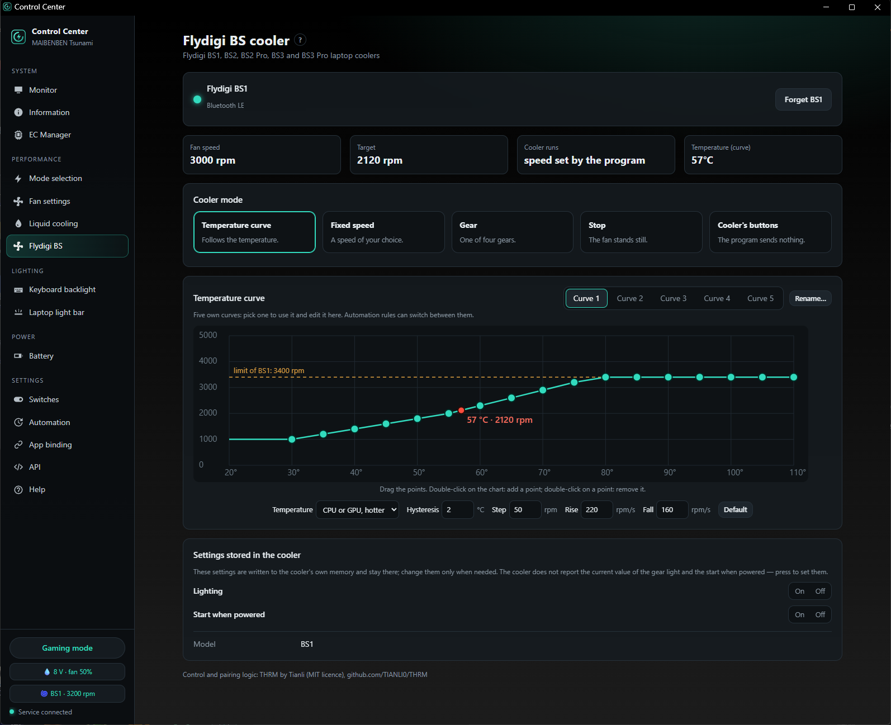

# Features

**English** · [Русский](FEATURES.ru.md) · details of what open-uniwill-cc does and how (EC registers, ACPI methods, WMI events).
Windows differences: [README.windows.md](../README.windows.md#differences-from-linux). Protocol: [PROTOCOL.md](PROTOCOL.md) (Russian).

## EC access without third-party drivers

The key difference from the original Control Center: on **Windows** the free build reaches the EC through the firmware's
own WMI method (`root\WMI AcpiTest_MULong.GetSetULong` → DSDT `WMBC` → `RKBC` / `WKBC`) and the WMI driver built into
Windows — no OEM driver and no other third-party driver; on **Linux** through the open kernel module `uwcc`. The OEM
driver stays an option for speed and for `PWUP` / `SMRW`. Comparison and measurements:
[EC/WMI-vs-Driver.md](EC/WMI-vs-Driver.md); EC Manager, platform profiles and the self-check:
[EC/Platforms.md](EC/Platforms.md).

## Modes: two kinds of platforms

The original service has two different mode managers and picks one by the project ID from the EC; this port does the same:

> **RamFan 1.5** is not a separate project: it is the name the original Uniwill service (GCUService,
> `MyFanManager_RamFan1p5`) gives to the fan control of the EC firmware. The fan curve (16 levels "temperature → speed"
> for CPU and GPU) lives in the EC RAM at `0xF00–0xF5C` and is handed over with `0xF5D–0xF5F`; with it come the Custom
> mode, PL1 / PL2 / PL4 / TCC and the Smart APC limit table. The EC reports it in `0x78E` bit 6 (*Information →
> RamFan 1.5*). Without it the program does not control the fans. ("RAM fan table, version 1.5" is our reading of the
> name; there is no public description.)

| | Commercial projects (PH4/PH6 list, `_CML` manager) | All other projects (RamFan1p5 manager) |
|---|---|---|
| Modes | Office, Gaming, Turbo | Office, Gaming, Turbo, **Custom** |
| Profiles | 3 per Office/Gaming | 2 per Office/Gaming/Turbo, **5 Custom slots** with your own names |
| Per profile | PL1/PL2 (AC and battery), cTGP, Dynamic Boost, fan curve | **PL1/PL2/PL4, TCC offset**, cTGP, Dynamic Boost, fan curve |
| Limits | from the factory fan tables | from the firmware **Smart APC table** (ACPI `SMRW`) |

In Custom mode the Fn mode key steps through the five slots. Each slot can be reset to the factory values (its curve too).

**Profile settings apply by themselves** (1.6.10): on the mode page a slider is written when it is released, a switch at
once; several quick changes become one write. *Apply the settings as soon as they change* (on by default) turns this
off and brings the *Apply* button back. `uwccctl set profile_autoapply on|off`.

**Super performance** (a switch of its own, works in any mode; `LoadOverClockingValue` of the original): fan mode byte
`0x751 = 0x10` (Turbo) with the Custom flag `0x726` bit 7 cleared, the factory `DefaultFanTable_Turbo`, cTGP = maximum +
Dynamic Boost with Dynamic Boost off; the PL limits of the current mode stay. **RAM overclocking** (also its own
switch) when `UniWillVariable.MemoryOverClockSupport = 1`: written to `UniWillVariable.MemoryOverClockSwitch`, which the
BIOS applies at the next boot; set to 0 by `uwccctl release` on uninstall.
`uwccctl status` shows which manager runs (`[cml]` / `[std]`). If the choice is wrong for your laptop, pick the other one in
*Settings → Switches → Fan manager* (or `uwccctl set fan_manager cml|std|auto`); the service restarts by itself.
Not ported from the RamFan1p5 manager: GPU core/memory clock offsets (NVAPI), CPU voltage offset (Intel OC SDK),
WhisperMode.

## Automation (Settings → Automation)

**Automatic profile switching** (1.6.8): rules like *"CPU + GPU power above 120 W for 30 s → Turbo, profile 2;
back to the previous mode when it has not held for 60 s"*, *"CPU power below 15 W for 60 s → Office"* or *"CPU above
90 °C or GPU above 85 °C for 20 s → Gaming"*. Up to 3 conditions per rule (and / or) on CPU, GPU or CPU + GPU power,
CPU / GPU temperature and load, RAM in use (% or GB, 1.8.2.3), battery charge, the power source (mains / battery), and the state: the laptop's mode,
the cooler profile in use (= / ≠) and whether another rule is on (its conditions held long enough, or it is active);
the target is a mode and a
profile slot (or the current one, or *keep the mode*), **Fan Boost** (*keep it / turn on / turn off*), and the liquid
cooler's mode (Automatic … Off, or *keep*) and profile. A rule must change at least one of them. Times in s / min / h
(up to 24 h), *for 0* = at once, on the first sample that meets the conditions. **Then:** *stay (do not return)*,
*return as soon as the condition stops*, or *return when it has not held for N* (the time is asked only for this
choice). On the return each item the rule changed is put back only if nobody changed it meanwhile. The card lists what
the rules did (the last 10, *Show all*: up to 100 kept since the service started; *Clear*, `uwccctl rules clear-log`).
Rules are checked from the top; the first that held long enough is applied once. While a rule is active, App binding and the power-source
settings do not change the mode. Needs full monitoring (*EC Manager → Monitoring*); without it the rules are paused.
`uwccctl rules …`.

**Averaged conditions** (1.8.1.0): a rule whose time is set in **minutes** (or hours) can compare the **one-minute
averages** instead of the instant values, so single spikes and dips between samples do not reset its timer; the choice
is made per rule (*of the one-minute averages* / *of the instant values*), and the current average is shown next to
each condition. A time in **seconds** always reacts to the instant values.


* **Power source:** a mode for "charger plugged in" (keep / the mode before unplugging / a mode) and for "unplugged";
  keyboard backlight off on battery; follow the mode with power-profiles-daemon / the Windows power mode (Turbo →
  performance, battery → power saver) and, the other way round, switch the laptop's mode when the system power profile
  changes (power saver / balanced / performance → a mode of your choice; the program's own changes are not followed
  back). The rules can also test the system power profile and Windows battery saver.
* **Overheating:** a desktop notice when the CPU or GPU stays at the limit (default 95 °C / 87 °C) for 30 s, at most once
  in 10 minutes; optionally Fan Boost is switched on if it is still hot 30 s later.

## Monitoring extras

* **History** on the Monitor page (1 min … 24 h, a point can be pinned for details, a period can be zoomed by dragging
  across the chart, CSV / JSON export): temperatures,
  load, clocks, CPU package power and power limits, GPU power, CPU + GPU and battery power, fans, cooler.
* **What the CPU values mean** (compared with OCCT, HWiNFO …): *power draw* is the RAPL **package** domain (Linux
  powercap `package-0`, Windows Energy Meter `rapl_package0_pkg`); the *clock* is the clock of the busy cores, as
  *Speed* in Task Manager (nominal × `% Processor Performance` on Windows, `scaling_cur_freq` on Linux) — not the
  "effective" clock of OCCT / HWiNFO, which averages in the time the cores sleep and is much lower at light load;
  the *temperature* is the EC sensor, the values are sampled every 2 s.
* **Discrete GPU** card on the Information page: whether the NVIDIA GPU sleeps and which programs keep it awake.
  The monitor no longer calls `nvidia-smi` while the GPU is in runtime suspend (that used to wake it every 2 s and drain the battery).
* **Fan curve presets** (Factory / Quiet = factory × 0.8, the OEM rule for its quiet table / Maximum) — loaded into the editor, saved with *Save*.
* **Fan settings editor:** the *Off, °C* row (where a level drops back) is hidden — it follows the next level's *On*
  by itself, keeping the distance the table had; *Show the return temperatures* brings it back. A red dot marks the
  fan's current temperature and speed (real rpm in the label); dragging a point on any chart shows its temperature
  and value next to it.
* **Webcam** switch (Settings → Switches): the camera is de-authorized on the USB bus, so no program can open it.

## Liquid cooling

Page **Performance → Liquid cooling** (or `uwccctl lc …`). Power the cooler on, press *Search*, then *Connect*.
The address is remembered and the service reconnects by itself, also after sleep. When the service stops and before
the system sleeps the cooler is put to sleep. Needs `python3-bleak` (installed by `install.sh`).

| Feature | How |
|---|---|
| Modes, first row: **Automatic** (curves by CPU/GPU temperature), **Follow the laptop** (curve of the laptop's mode), **Controller** (EC targets), **Manual**; second row: High 90 %/11 V, Medium 50 %/8 V, Low 25 %/7 V, Off | fan `0x1B`, pump `0x1C` |
| **Curves** (1.6.8): a fan curve (2..17 points, linear between them) and pump steps (one draggable point per allowed voltage, down only 3 °C below a step; the *Off* point is *Stop the pump when it is cool*), edited by dragging; a red dot shows the current temperature and value. One **common** curve (Automatic, and Follow the laptop for modes without their own); in Follow the laptop each mode — Office, Gaming, Turbo, Custom — can have **its own curve**; a change of the laptop's mode switches the curve at once (the fan still ramps) | |
| **Own pump voltage limits** (after a risk warning): choose which of 7 / 8 / 11 / 12 V may be used — the cooler firmware knows only these and cannot report what a pump supports; a voltage outside the choice becomes the nearest allowed one in every mode | |
| **Controller** mode: the curves are shown but cannot be edited (the EC drives the cooler; the common curve is used only when the EC publishes no targets) | |
| **Cooler profiles** (block *Profiles* under the charts): Default (factory steps), Quiet, Balanced, Performance and your own — *Apply*, *Save*, *New…* (the current curves as a new profile), *Remove*, *Export* / *Import…* (a JSON file). A profile holds the common and the per-mode curves **and the Behaviour** (temperature source, up / down delays, smoothing, stopping the pump when cool); a profile chosen in the list is shown on the charts and its Behaviour read-only until *Apply*. Built-in Behaviour: Default and Balanced 10 s up / 30 s down, Quiet 20 / 60 s, Performance 5 / 60 s. Profiles saved by 1.6.8–1.6.10 have no Behaviour and keep the current one | |
| **Behaviour belongs to the profile** (1.6.12): a change applies at once and is kept in the own profile in use (a built-in one becomes *changed* — *New…* keeps it); the block follows a profile change at once, also one made by a rule. Profiles saved by 1.6.8–1.6.10 get the Behaviour in use when the service starts | |
| Lighting: static, breathing, rainbow, breathing rainbow; Mk2 also spiral, rotating rainbow, colour wave | `0x1E` / `0x33` |
| Coolant flow check every 15 s with a desktop alert when the pump runs but nothing circulates | `0x32` |
| Coolant filling cycle (8 pump pulses, ~70 s) | `0x19` |
| Fn cooler boost keys (fan ≥ 60 %, pump ≥ 8 V); EC told that a cooler is attached (`0x7C7` bit 1) on laptops that declare support | WMI `0xCD`/`0xCE` |
| **Flow guard:** with no coolant flow the pump goes to 11 V and the fan to ≥ 60 % until the laptop's mode changes or you pick a setting | |

```bash
uwccctl lc scan                      # find coolers
uwccctl lc connect C0:FF:EE:..:..:.. # connect and remember
uwccctl lc mode auto                 # auto | laptop | ec | manual | high | medium | low | off
uwccctl lc manual 60 8               # fan 60 %, pump 8 V
uwccctl lc curve common fan 40:25 60:45 80:80 95:100 pump 0:8 70:11
uwccctl lc curve turbo flat 90       # Follow the laptop: Turbo at 90 %;  uwccctl lc curve turbo off
uwccctl lc profile apply quiet       # cooler profiles: list | apply | save | copy NAME | remove | rename | export | import
uwccctl lc rgb 00ffff breathe        # colour and effect;  uwccctl lc rgb off
uwccctl lc prime                     # filling cycle
```

The built-in curves start at 8 V: on some units the flow does not hold at 7 V and the cooler switches itself off
(the OEM service never goes below 8 V either). 7 V is still available on a curve and by hand. A curve has no 12 V (only with own
pump limits). The pump is stopped by *Stop the pump when it is cool* — the *Off* point on the pump chart: dragged to a
temperature, the pump stops below it (after the minimum run time, 120 s by default) and starts again a few degrees
above it; at the left edge it is off.

**Update from 1.6.7 or older:** the temperature tiers become the common curve with the same behaviour, and the old
fixed duties of *Follow the laptop* (Office 40 %, Gaming 60 %, Turbo / Custom 90 %, pump 11 V) become flat curves of
those modes. A new install starts with the Default profile and no per-mode curves.

**Cooler firmware.** open-uniwill-cc shows the cooler firmware version but does not flash it: a failed DFU update can
leave the cooler unusable. Use the vendor tool or nRF Connect with the right package if you really need an update.

## Flydigi BS coolers



Page **Performance → Flydigi BS** (or `uwccctl flydigi …`), new in 1.8.2.7. Coolers: **BS1, BS2, BS2 Pro, BS3,
BS3 Pro**. The page is a service module: *Switches → Service modules → Flydigi BS cooler*; off, the page is hidden and
the program leaves the cooler alone. Since 1.8.2.8 it has its own group in *Switches → Flydigi BS*: **Enable
Flydigi BS** and, under it, **Flydigi BS — add to the automation rules** (on by default since 1.9.2.0, works only while
Flydigi BS is on). The first visit of the page says that it is a port of THRM and offers to turn the component off.

The protocol and the control and pairing logic are ported from [THRM](https://github.com/TIANLI0/THRM) by Tianli
(MIT) with the same commands, sequences and timings — `uwccd/flydigi/`, each function names the THRM function it
comes from.

**Connecting.** Every Flydigi BS model is found by Bluetooth LE: **Search by Bluetooth** (up to 10 s, needs
`python3-bleak` on Linux). How each one is then controlled is THRM's:

- **BS1** takes commands directly over Bluetooth LE: the search connects it at once, and it is remembered and
  connected again by itself. It can also be plugged in by USB (found by itself).
- **BS2 / BS2 Pro / BS3 / BS3 Pro** are controlled as an HID device over Bluetooth (HID over GATT), which the system
  opens only to a **paired** device: pair the cooler **once in the system's Bluetooth settings** (or plug it in by
  USB). It then appears as an HID device (VID `37D7`) and the service finds it by itself — also after sleep or when it
  comes back. If the search finds one that is not paired yet, the page says so (on Windows with a link to the
  Bluetooth settings).

The service does not scan Bluetooth LE in the background for a cooler it has never seen.

| Mode | What the cooler does |
|---|---|
| **Temperature curve** | the fan speed follows the hotter of CPU and GPU (or one of them) by the curve; THRM's default curve and smoothing: hysteresis 2 °C, smallest change 50 rpm, at most +220 / −160 rpm per second. **Five own curves** (1.9.0.0): *Curve 1…5* above the chart, each can be renamed; the one picked is used and edited, automation rules can switch to any of them. Edits are a draft (1.9.2.0): **Apply** uses the curve without keeping it, **Save** keeps it in the curve; *Apply changes at once* applies and saves every edit as before |
| **Fixed speed** | one speed, 0–5000 rpm (BS1: up to 3400 rpm) |
| **Gear** | one of the four gears — Quiet / Standard / Strong / Overclock — with THRM's low / medium / high speeds (1300…4000 rpm); the speed is written to the gear only when the cooler does not hold it yet |
| **Stop** | 0 rpm |
| **Cooler's buttons** | the program sends nothing |

How the speed is set (THRM): realtime mode is entered once and the same speed is not sent again; after 0 rpm the fan
is started through the cooler's own start path (gear, 450 ms, then at least 1700 rpm, then the target) and checked
3 s later; three failed writes are followed by a read-only check before the connection is dropped. A physical gear
button puts the cooler back in gear mode, and the next speed enters realtime mode again.

**Highest speed.** The protocol takes 0–5000 rpm for every model, but a fan stops at its own ceiling: BS1 is rated
3000 rpm on its top gear and reaches about 3400 rpm, so for BS1 the speed, the curve and the rules are cut to 3400 rpm
(the default curve is fitted to it; the curve shows the limit as a dashed line). The top speeds also need a PD charger:
18–20 W for BS1 and BS2, 27 W for BS2 Pro — from a laptop USB port or a charger without PD the top gear stays locked.
When the fan stays below 90 % of the set speed for 25 s, the page says so.

**Settings stored in the cooler:** lighting on/off (all models; the page shows its current state), and on BS2 and
later the gear light, start when powered, smart start/stop (BS1: only start when powered). They are written
to the cooler's memory, at least 150 ms apart and only when they change; the page also shows the firmware, the device
ID, the capability tier and the gear speeds stored in the cooler. A cooler with capability tier 1 or 2 (e.g. not
enough power) cannot select every gear — the page says so.

**Automation** (while *Flydigi BS — add to the automation rules* is on). A rule can set the Flydigi cooler's mode (with its speed or gear) and put it back when the rule is
over; conditions *Flydigi fan speed* (rpm) and *Flydigi cooler* (connected / not connected). Template *Hot → Flydigi
cooler at 4000 rpm*. While the component is on, the cooler's fan speed is shown on *Monitor → Fans* and in the
sidebar (since 1.8.2.8); it is also in the history (*Fans*) and its CSV export (`flydigi_fan_rpm`).

```bash
uwccctl flydigi                      # state
uwccctl flydigi mode curve           # curve | rpm | gear | stop | device
uwccctl flydigi rpm 3000
uwccctl flydigi gear 3 high          # gear 1-4, low | mid | high
uwccctl flydigi curve 40:1400 60:2300 80:3500 90:4000   # or: curve reset
uwccctl flydigi light off            # gear light; power-on-start on|off; smart-stop off|immediate|delayed
uwccctl flydigi search               # BS1 by Bluetooth LE
```

On Linux the service runs as root and reads `/dev/hidraw*` directly; no udev rule is needed.

## Control Center 3.0 / Clevo (experimental, separate module)

Laptops with Control Center 3.x have no Uniwill EC; the module `uwccd/clevo/` drives them with Clevo DCHU commands
(ACPI `_DSM` of `CLV0001`): power modes, fan modes / offset / custom curve / anti-dust, fan monitoring, keyboard
colour / brightness / effects / sleep timer / boot effect. Windows: the Control Center 3 driver; Linux: the `uwcc`
module. Also Tongfang laptops with Control Center 3.x, where reports confirmed that all functions work. Since 1.7.0
on the usual pages (*Mode selection*, *Fan settings*, *Keyboard backlight*), the tray, the automation rules and
`uwccctl mode`; the custom curve is exported / imported in its own file format. Still experimental (badge
*CC 3.0 · EXPERIMENTAL*); commands are off until allowed — [CLEVO.md](CLEVO.md).

## Leishen / Thunderobot (experimental, separate module)

Thunderobot laptops built by Quanta with Leishen ControlCenter 3.x (e.g. R16) have neither the Uniwill nor the Clevo
interface; the module `uwccd/leishen/` uses their firmware's WMI block `RW_GMWMI`: temperatures and fan speeds, power
mode, own fan speeds or a curve, Windows key, touchpad, RGB keyboard light, the mode key. Checked on a Thunderobot
R16. Since 1.7.0 on the usual pages (*Switches*: Windows key, touchpad), the tray, the rules and `uwccctl mode`; still
experimental (badge *LEISHEN · EXPERIMENTAL*); commands are off until allowed — [LEISHEN.md](LEISHEN.md).

## MSI Afterburner

Windows, experimental, since 1.7.1: every mode — and every preset of a mode (Turbo 1 / 2, Custom 1–5) — can switch an MSI Afterburner profile slot 1–5 (the overclock stays in
Afterburner); by default no mode changes it. Applied when the mode changes, when the service starts and when
Afterburner starts later; *Start Afterburner if it is not running* (on). Card on *Mode selection*, tray, `uwccctl
afterburner` — [AFTERBURNER.md](AFTERBURNER.md).

## Platform window

At the first start — and again when what it shows changes (a driver installed, commands allowed) — a window shows
the laptop, the platform found and its level, and *What can be controlled*. For every function that does not work it
says why and offers the next step: *Allow commands* (experimental module), *Install the OEM driver*, *Run the
self-check* (an unknown project, WMI without a profile), or *Make a report and send it* — the report is made and the
GitHub issue form *New laptop* opens with the laptop, the platform and the functions filled in; the zip is attached by
hand, nothing is sent by itself. Serial numbers, the system UUID, MAC addresses, the computer and user names stay out of
the report unless ticked. *Information → Check the platform*, `uwccctl detect`.

## Colour calibration

*Keyboard backlight* and *Laptop light bar* → **Colour calibration → Calibrate…** (1.8.2.5). The LEDs do not always
show the colour that is sent: the channels can be wired in another order (the front bar of XMG NEO 16 E25 shows some
colours swapped — in the OEM program too), one colour can bleed into another, white can be tinted.

The device shows pure **red**, **green** and **blue** as they are sent, and you pick the colour you see for each
(the closest button or an exact colour); then, optionally, **white** for its tint. From these the program works out
how the device mixes the channels and corrects every colour before it is sent: swapped channels are swapped back, a
colour that bleeds is subtracted, the strong channels of a tinted white are lowered. At the end the device shows test
colours with the correction. *Reset* forgets it.

Each device has its own calibration: the RGB keyboard (static colours, effects, per-key modes, BetterRGB), the
one-zone RGB keyboard on the EC and the light bar. BetterRGB's *Calibrate white* is the white step of the keyboard's
calibration; white gains set in an older version are kept. `uwccctl calibrate …`. The accuracy is that of the
colours picked by eye: swapped channels and a visible tint are fixed well, fine shades only roughly.

## Diagnostic report

*Information → Diagnostic report* or `uwccctl report` makes a zip file with everything needed to add support for
another laptop or to look into a problem: the EC registers the program uses, BIOS settings (UniWillVariable, SmartAPC),
keyboard and light bar devices, NVIDIA limits, sensors, the self-check (stage 1) and the service log. Nothing is changed
on the laptop. Serial numbers, UUID, MAC addresses, the computer and user names are hidden unless you tick them (inside
ACPI tables too, keeping the same length). The report lists the functions you unlocked yourself (1.8.2.0).

## What was ported

✅ works · ❌ not available · ➖ not needed / not applicable. Linux and Windows run the same service code; only the access
to the hardware differs (see the last section).

| Control Center feature | Linux | Windows | Implementation |
|---|:-:|:-:|---|
| Office / Gaming / Turbo mode, Fn mode key, OSD | ✅ | ✅ | EC `0x751`, NVRAM `PowerMode`, event `0xB0` |
| Profiles 1–3 for Gaming and Office | ✅ | ✅ | `Mode1/2_Profile*.json`, tables `M1T1…M2T3` |
| Custom mode with 5 slots, PL4, TCC offset, Smart APC limits (RamFan1p5 platforms) | ✅ | ✅ | EC `0x785/0x786/0x787`, `0x726` bit 7, ACPI `SMRW` |
| Fan Boost | ✅ | ✅ | bit 6 of `0x751`, event `0xA7` |
| CPU/GPU fan curves (16 levels), presets, factory reset | ✅ | ✅ | EC `0xF00–0xF5F`, factory tables from the EC (handshake `0xF5D/F5E/F5F`) |
| PL1/PL2 on AC and battery, factory PL from the EC | ✅ | ✅ | EC `0x783/0x784`, `0x730–0x737`, `0x7A7–0x7AA` |
| CPU temperature limit (TCC offset) | ✅ | ✅ | EC `0x786` |
| NVIDIA cTGP and Dynamic Boost | ✅ | ✅ | EC `0x743–0x746`; Dynamic Boost needs `nvidia-powerd` (Linux) / the NVIDIA service (Windows) |
| NVIDIA GPU temperature limit | ✅ | ✅ | `nvidia-smi -gtt` (Linux), NVAPI client thermal policies (Windows) |
| Balanced protection PH6PG0x/3x/7x (thermal profile S2) | ✅ | ✅ | EC `0x726`, event `0xCB` |
| Super performance (any mode) | ✅ | ✅ | `0x751 = 0x10`, factory Turbo table, cTGP maximum + Dynamic Boost |
| RAM overclocking | ✅ | ✅ | NVRAM `MemoryOverClockSwitch` (applied by the BIOS at the next start) |
| Power boost with the liquid cooler (CoolingOC / LiquidHWOC) | ✅ | ✅ | EC LC fan table `0xF5F`, firmware `INOU.PWUP` (kernel module ioctl / `UWACPIDriver`) |
| Monitor: temperatures, load, clocks, fans (%, rpm), power, memory, network, drives, battery | ✅ | ✅ | fans — EC `0x75B/0x75C`, `0x464/0x46B`; Linux: hwmon, RAPL, `/proc`, `nvidia-smi`; Windows: ACPI thermal zone, Energy Meter / processor counters, `nvidia-smi` |
| History 1 min … 24 h, export CSV / JSON | ✅ | ✅ | service-side recording, 24 h kept on disk |
| "Who keeps the discrete GPU awake" | ✅ | ❌ | runtime PM + process scan |
| ITE keyboard lighting: hardware effects, brightness, speed, direction, colours, multicolour | ✅ | ✅ | HID feature reports 08h/09h/14h (hidraw / hid.dll) |
| Four-zone ITE keyboards (usage page FF12, e.g. MAIBENBEN Tsunami) | ✅ | ✅ | Single, Breathing, Wave, Rainbow, Flash, Mix; smooth Wave, Colour wave, Flash, Neon, Stack, Impact drawn zone by zone |
| User mode (per-key colour) and gaming mode (WASD/arrows) — per-key keyboards | ✅ | ✅ | picture 12h / rows 16h |
| Software effects Neon, Stack, Impact, Alphabet | ✅ | ✅ | frames from `AP_Effect_Task` (`uwccd/lighting/oem`, proprietary) |
| Reactive effects (Reactive, Ripple, Aurora, Spark) light pressed keys | ✅ | ✅ | EC `0x741` bit 3 |
| *Not in the original:* untested effects — the greyed effects (not offered for this keyboard type by the original window, light-bar effects on a keyboard) can be tried: *Unlock untested effects*, a question before the first try, then *Does it work? Yes / No* (kept per keyboard, part of the diagnostic report). Music mode stays off | ✅ | ✅ | the same `08h` effect command; nothing is stored in the controller; `uwccctl kb effect NAME --try`, `uwccctl kb feedback NAME yes\|no` |
| *Not in the original:* 17 BetterRGB effects (Wave, Sparkle, Lightning, Flame, Rain, Matrix, Quicksand, Current, Screen ambient, CPU / GPU temperature …) | ✅ | ✅ | frames from `uwccd/lighting/fx.py` (from BetterRGB, MIT): picture 12h on per-key keyboards, zone colours on four-zone ones — [LIGHTING.md](LIGHTING.md) |
| *Not in the original:* transitions, white calibration, top-row bar, frame rate on AC / battery | ✅ | ✅ | `uwccd/lighting/fx.py`; key presses: Linux `/dev/input`, Windows the tray app; screen: Windows tray app, Linux agent (X11) |
| LED colour correction per keyboard type / LED vendor | ✅ | ✅ | `WKDColor.cheatRGB_*` (`uwccd/lighting/oem`, proprietary) |
| Chassis light bar (hinge / base / logo) | ✅ | ✅ | HIDLightbar4, HID `048D:7000`; front bar `048D:7001` (XMG NEO 16 E25 / TUXEDO Stellaris Gen7: own protocol from 1.8.2.4, facts from tuxedo-drivers `ite_8291_lb`; static colour and breathing; confirmed on XMG NEO 16 E25, Windows, 1.9.0.0) |
| Light bar power through the EC (the Fn key's switch), on the *Laptop light bar* page | ✅ | ✅ | EC `0x767` bit 1 (trigger), state `0x768` bit 1; models with an RGB light bar in `0x78E` bit 4 |
| Single-colour backlight (on/off, level) | ✅ | ✅ | EC `0x78C` |
| Backlight auto-off on inactivity | ✅ | ✅ | Linux: `/dev/input` events; Windows: idle time of the tray app |
| Windows key lock, Fn Lock | ✅ | ✅ | EC `0x767/0x768`, `0x74E`, NVRAM `FnKeyStatus` |
| USB charging in sleep, touchpad toggle, touchpad LED | ✅ | ✅ | EC `0x767` bit 4, `0x7A6`; touchpad on Windows: Win+Ctrl+F24 |
| Power on with AC | ✅ | ✅ | NVRAM `ACRecoveryStatus` or EC `0x726` bit 3 |
| NVIDIA Optimus / MUX (discrete GPU direct) | ✅ | ✅ | NVRAM `OemDisplayMode`, after a restart |
| Webcam switch | ✅ | ✅ | Linux: USB de-authorisation; Windows: `Disable-PnpDevice` |
| Wi-Fi / Bluetooth switches | ✅ | ❌ | rfkill |
| Battery protection modes (full / balanced / stationary) | ✅ | ✅ | EC `0x7A6` bits 4–5 |
| Custom charge limits | ✅ | ✅ | EC `0x7B9`, `0x7D0`, NVRAM `Charge*Limit` |
| Type-C charging priority | ✅ | ✅ | EC `0x7CC` bit 7 |
| Automation: mode per power source, overheating alerts, follow the power profile (both ways) | ✅ | ✅ | power-profiles-daemon (Linux) / Windows power mode |
| *Not in the original:* automatic profile switching by power, temperature, load, battery, power source, system profile | ✅ | ✅ | `uwccd/automation.py`, needs full monitoring |
| App binding | ✅ | ✅ | process watch |
| Liquid cooling over Bluetooth (BT Cooling) | ✅ | ✅ | `bleak` (BlueZ / WinRT); see above |
| Liquid cooler firmware update (DFU) | ❌ | ❌ | not done on purpose: a failed update can leave the cooler unusable |
| Updates of this program | ✅ check | ✅ download + install | GitHub releases, checked against `SHA256SUMS.txt` |
| Diagnostic report for new laptops / bug reports | ✅ | ✅ | `uwccctl report`, *Information → Diagnostic report*; serial numbers, UUID, MAC, computer and user names hidden unless ticked (also inside ACPI tables, with the same length) |
| Platform profiles, EC self-check, administrator unlock of EC settings | ✅ `uwccctl ec` | ✅ EC Manager | [EC/Platforms.md](EC/Platforms.md) |
| EC access without the OEM driver: Windows WMI (open, beta) | ➖ | ✅ beta | `root\WMI AcpiTest_MULong`; no `PWUP` / `SMRW`, ~125 ms per access — see [EC/WMI-vs-Driver.md](EC/WMI-vs-Driver.md) |
| Full control from the command line (`uwccctl`, JSON output) | ✅ `man uwccctl`, bash completion | ✅ `uwccctl help` | everything the window changes; see [CLI.md](CLI.md) |
| Restart of a hung service | ✅ | ✅ | Linux: agent notice + polkit; Windows: tray with UAC |
| Keyboard power-on (welcome) effect | ❌ | ❌ | stored in a UEFI variable whose layout is not verified yet |
| Music lighting effect | ❌ | ❌ | needs audio capture (WASAPI in the original) |
| StarHitting / StarSpark | ➖ | ➖ | light bar only in the original |
| Display colour calibration, display modes (ICC / gamma) | ❌ | ❌ | Linux: GNOME Settings → Color; Windows: the system colour settings |
| Overclocking (Intel OC SDK, NVIDIA clock offsets), WhisperMode 2.0 | ❌ | ❌ | not ported (for NVIDIA on Linux: `nvidia-settings`) |
| Game monitor (FPS overlay), Dynamic Desk, key remapping | ❌ | ❌ | Windows-specific in the original; MangoHud is an overlay alternative on Linux |
| OTA — BIOS / EC / Control Center updates from the vendor server | ❌ | ❌ | firmware is not flashed by this program: use the vendor tools |
| MQTT — internal message bus between the original service, window and tray | ➖ | ➖ | replaced by the local HTTP API + server-sent events with a token |

### Hardware access: Linux and Windows

| | Linux | Windows |
|---|---|---|
| EC | kernel module `uwcc` (`/dev/uwcc`, DKMS), fallback `acpi_call` | OEM driver `UWACPIDriver.sys` (`\\.\ACPIDriver`) |
| Hot keys | WMI events through the module, fallback EC polling | WMI `AcpiTest_EventULong` |
| UEFI variable `UniWillVariable` | `/sys/firmware/efi/efivars` | `GetFirmwareEnvironmentVariable` |
| Keyboard / light bar | hidraw | SetupAPI + hid.dll |
| Desktop part | session agent `uwcc-agent` (notifications, OSD) | tray app `ControlCenter.exe` |
| Service | systemd `uwccd.service` | Windows service `uwccd` |
