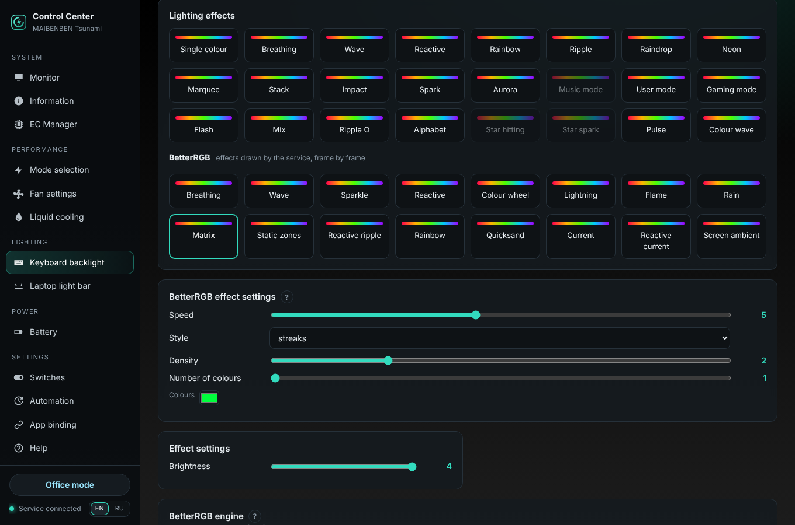

# BetterRGB keyboard effects

**English** · [Русский](LIGHTING.ru.md)

Since 1.6.3 the program has 16 more keyboard effects that the service draws itself, frame by frame. They come from
[BetterRGB ITE8291 Adaptive](https://github.com/ZavierChen/BetterRGB-ITE8291-Adaptive) by ZavierChen, which is based
on [Better RGB](https://github.com/EpicYamo/Better-RGB-for-Tongfang-ITE8291) by TheYamo (both MIT). They were
rewritten in Python for this program (`uwccd/lighting/fx.py`); see [NOTICE.md](../NOTICE.md).

*Keyboard backlight → BetterRGB* in the window, `uwccctl kb fx` on the command line.



## How it works

The firmware effects (*Lighting effects* above) run inside the ITE keyboard controller. A BetterRGB effect is a
picture of all keys that the service computes 10–60 times a second and sends to the controller:

| Keyboard | What is sent |
|---|---|
| per-key RGB (ITE, usage page `FF03`) | the user-mode picture, the same packets BetterRGB sends: `08h` user mode, `12h`, 8 × 65-byte rows |
| four-zone RGB (usage page `FF12`, e.g. MAIBENBEN Tsunami) | four zone colours: each zone shows the average colour of its keys |

The keys are the 6 × 21 grid of the Uniwill ITE controller; BetterRGB itself is laid out for a Tongfang keyboard
(ITE `048D:600B`). Rain, Matrix or Lightning look like pictures only on per-key keyboards; on four zones they become
colours flowing over the zones.

> **Tested:** the four-zone path on MAIBENBEN Tsunami. The per-key path uses the packets of the original Control
> Center user mode and of BetterRGB, but it has not been tried on a per-key keyboard with this program yet — a report
> helps (*Information → Diagnostic report*).

## Effects

| Effect | Parameters | Needs |
|---|---|---|
| Breathing | speed, smoothness (steps), random colours, colour | |
| Wave | speed, angle | |
| Sparkle | speed, density | |
| Reactive | afterglow (short / medium / long), random colours, colour | key presses |
| Colour wheel | speed, reverse direction | |
| Lightning | speed, smoothness, width, strikes at once | |
| Flame | speed, smoothness | |
| Rain | speed, density, number of colours, colours (up to 5) | |
| Matrix | speed, style (streaks / columns / lasers / ripples), density, number of colours, colours (up to 3) | |
| Static zones | layout (rows / columns), zones (up to 6 / 10), colours | |
| Reactive ripple | speed, width, random colours, colour | key presses |
| Rainbow | speed | |
| Quicksand | speed, scale, three colours | |
| Current | speed, width, three colours | |
| Reactive current | speed, width, three colours | key presses |
| Screen ambient | blur, response | the screen |

Brightness is the usual *Brightness* slider (0–4).

### Key presses and the screen

The service cannot see your keyboard input or screen on Windows (it runs in session 0), so the user-session program
sends them — **only while an effect that needs them runs**, and nothing is stored:

| | Windows | Linux |
|---|---|---|
| key presses | the tray program (`ControlCenter.exe`) polls the keys 60 times a second and sends the names of newly pressed keys | the service reads `/dev/input` itself |
| screen | the tray program sends a 64 × 24 picture of the main screen 15 times a second | the session agent (`uwcc-agent`) — X11 only, not on Wayland; **off by default**: *BetterRGB engine → Allow Screen ambient* (`uwccctl set kb_fx_screen on`) |
| volume | Core Audio | `pactl` (PipeWire / PulseAudio) |
| microphone / playback level | Core Audio peak meters | — |

The key positions are approximate (the key layout of each laptop differs); the reactive effects light the key at
its place in the grid or next to it.

## Engine settings

| Setting | |
|---|---|
| Frames per second on AC / on battery | 10–60 (default 30 / 15). If the keyboard does not keep up, the rate goes down by 5 after three slow frames and back up one step after 10 calm seconds. Four-zone keyboards: at most 25. |
| Transition | off, fade, ripple from the centre / the edges, wipe from a side, twin spirals — when an effect starts, when the backlight goes dark after inactivity and when it comes back |
| Transition time | 100–5000 ms (default 800) |
| White calibration | see below |
| Top-row bar | see below |

Inactivity uses the setting *Keyboard backlight auto-off* (Switches): with a BetterRGB effect the keys fade out with
the chosen transition and fade in at the next key press or mouse move.

### White calibration

LEDs of some keyboards show white with a tint. *Calibrate white* shows raw full white on all keys; pick in the
colour field the colour you **actually see** and press *Apply*. The program computes a gain for each channel in
linear light (it only lowers the stronger channels) and applies it to every BetterRGB frame. *Reset calibration*
returns to neutral.

### Top-row bar (per-key keyboards)

The 20 keys of the top row show a level over the effect: battery charge, volume, microphone level, CPU load, GPU
load or playback level, filling left to right, right to left, from the edges or from the centre, in a colour going
from *from* to *to* (playback: three colours flowing). A volume change shows the volume for 1.8 s. CPU and GPU load
come from the monitor, so they need monitoring on (*EC Manager → Monitoring*).

## Command line

```bash
uwccctl kb fx                                             # effects, parameters, settings
uwccctl kb fx matrix style=lasers density=4 --light 3
uwccctl kb fx static zones=4 layout=vertical colors=FF0000,00FF00,0000FF,FFFFFF
uwccctl kb fx-config fps_battery=20 transition=snake_main_in_out transition_ms=1200
uwccctl kb fx-config bar=battery bar_direction=center_to_edges bar_start=00FF50 bar_end=FF1400
uwccctl kb fx-calibrate start
uwccctl kb fx-calibrate apply FFE8D0                      # the colour you see
```

API: `POST /api/keyboard/effect {"effect": 100..115, "light": 0..4, "fx": {...}}`, `POST /api/keyboard/fx/config`,
`POST /api/keyboard/fx/calibrate {"action": "start|apply|cancel|reset", "observed": [r, g, b]}`.

## Not taken over

Separate effects and brightness on AC and on battery (here: a separate frame rate on battery, and *Automation* can
switch the backlight off on battery), the Fn hotkeys of BetterRGB (the program has its own), the game frame-rate bar
(disabled in BetterRGB too).
