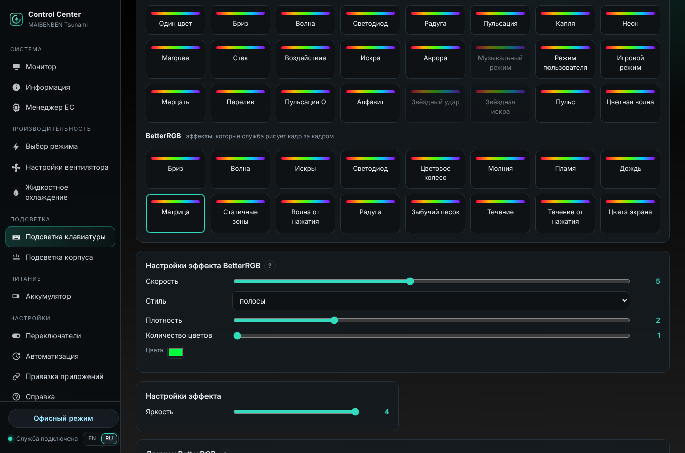

# Эффекты клавиатуры BetterRGB

[English](LIGHTING.md) · **Русский**

С версии 1.6.3 в программе есть ещё 16 эффектов клавиатуры, которые служба рисует сама, кадр за кадром. Они взяты из
[BetterRGB ITE8291 Adaptive](https://github.com/ZavierChen/BetterRGB-ITE8291-Adaptive) (автор ZavierChen), который
основан на [Better RGB](https://github.com/EpicYamo/Better-RGB-for-Tongfang-ITE8291) (автор TheYamo); оба под MIT.
Для этой программы они переписаны на Python (`uwccd/lighting/fx.py`); см. [NOTICE.md](../NOTICE.md).

В окне — *Подсветка клавиатуры → BetterRGB*, в командной строке — `uwccctl kb fx`.



## Как это работает

Эффекты прошивки (*Световые эффекты* выше) выполняет сам контроллер клавиатуры ITE. Эффект BetterRGB — это картинка
всех клавиш, которую служба рассчитывает 10–60 раз в секунду и отправляет контроллеру:

| Клавиатура | Что отправляется |
|---|---|
| RGB с подсветкой каждой клавиши (ITE, usage page `FF03`) | картинка пользовательского режима — те же пакеты, что отправляет BetterRGB: `08h` пользовательский режим, `12h`, 8 строк по 65 байт |
| четырёхзонная RGB (usage page `FF12`, например MAIBENBEN Tsunami) | четыре цвета зон: каждая зона показывает средний цвет своих клавиш |

Клавиши — это сетка 6 × 21 контроллера ITE Uniwill; сам BetterRGB рассчитан на клавиатуру Tongfang (ITE `048D:600B`).
Дождь, Матрица или Молния выглядят как картинка только на клавиатурах с подсветкой каждой клавиши; на четырёх зонах
они превращаются в переливы цвета по зонам.

> **Проверено:** четырёхзонный вариант на MAIBENBEN Tsunami. Для клавиатур с подсветкой каждой клавиши используются
> пакеты пользовательского режима оригинального Control Center и BetterRGB, но с этой программой на такой клавиатуре
> они ещё не проверялись — отчёт поможет (*Информация → Диагностический отчёт*).

## Эффекты

| Эффект | Параметры | Нужно |
|---|---|---|
| Бриз (Breathing) | скорость, плавность (ступени), случайные цвета, цвет | |
| Волна | скорость, угол | |
| Искры | скорость, плотность | |
| Светодиод (Reactive) | послесвечение (короткое / среднее / долгое), случайные цвета, цвет | нажатия клавиш |
| Цветовое колесо | скорость, обратное направление | |
| Молния | скорость, плавность, ширина, разрядов одновременно | |
| Пламя | скорость, плавность | |
| Дождь | скорость, плотность, количество цветов, цвета (до 5) | |
| Матрица | скорость, стиль (полосы / столбцы / лазеры / круги), плотность, количество цветов, цвета (до 3) | |
| Статичные зоны | расположение (ряды / столбцы), зоны (до 6 / 10), цвета | |
| Волна от нажатия | скорость, ширина, случайные цвета, цвет | нажатия клавиш |
| Радуга | скорость | |
| Зыбучий песок | скорость, масштаб, три цвета | |
| Течение | скорость, ширина, три цвета | |
| Течение от нажатия | скорость, ширина, три цвета | нажатия клавиш |
| Цвета экрана | размытие, отклик | экран |

Яркость — обычный ползунок *Яркость* (0–4).

### Нажатия клавиш и экран

На Windows служба не видит ввод с клавиатуры и экран пользователя (она работает в сеансе 0), поэтому их передаёт
программа сеанса — **только пока работает эффект, которому они нужны**, и ничего не сохраняется:

| | Windows | Linux |
|---|---|---|
| нажатия клавиш | программа в трее (`ControlCenter.exe`) 60 раз в секунду опрашивает клавиши и передаёт названия только что нажатых | служба сама читает `/dev/input` |
| экран | программа в трее 15 раз в секунду передаёт картинку основного экрана 64 × 24 | агент сеанса (`uwcc-agent`) — только X11, не Wayland; **по умолчанию выключено**: *Движок BetterRGB → Разрешить «Цвета экрана»* (`uwccctl set kb_fx_screen on`) |
| громкость | Core Audio | `pactl` (PipeWire / PulseAudio) |
| уровень микрофона / воспроизведения | индикаторы пиков Core Audio | — |

Положения клавиш приблизительные (раскладка у ноутбуков разная): реактивные эффекты зажигают клавишу на её месте в
сетке или рядом.

## Настройки движка

| Настройка | |
|---|---|
| Кадров в секунду от сети / от батареи | 10–60 (по умолчанию 30 / 15). Если клавиатура не успевает, частота снижается на 5 после трёх медленных кадров и возвращается на шаг после 10 спокойных секунд. Четырёхзонные клавиатуры: не больше 25. |
| Переход | выкл., затухание, волна из центра / от краёв, шторка с одной стороны, двойные спирали — при запуске эффекта, при гашении подсветки после бездействия и при её возвращении |
| Длительность перехода | 100–5000 мс (по умолчанию 800) |
| Калибровка белого | см. ниже |
| Полоса в верхнем ряду | см. ниже |

Бездействие берётся из настройки *Автоотключение подсветки клавиатуры* (Переключатели): с эффектом BetterRGB клавиши гаснут
выбранным переходом и плавно загораются при следующем нажатии или движении мыши.

### Калибровка белого

Светодиоды некоторых клавиатур показывают белый с оттенком. *Калибровать белый* — все клавиши показывают «сырой»
полный белый; выберите в поле цвета тот цвет, который вы **действительно видите**, и нажмите *Применить*. Программа
рассчитывает коэффициент для каждого канала в линейном свете (она только понижает более сильные каналы) и применяет
его к каждому кадру BetterRGB. *Сбросить калибровку* — вернуть нейтральную.

### Полоса в верхнем ряду (клавиатуры с подсветкой каждой клавиши)

20 клавиш верхнего ряда показывают уровень поверх эффекта: заряд батареи, громкость, уровень микрофона, загрузку ЦП,
загрузку ГП или уровень воспроизведения; заполнение слева направо, справа налево, от краёв или от центра, цветом от
*от* до *до* (воспроизведение — переливом трёх цветов). При изменении громкости на 1,8 с показывается громкость.
Загрузка ЦП и ГП берётся из мониторинга, поэтому он должен быть включён (*Менеджер EC → Мониторинг*).

## Командная строка

```bash
uwccctl kb fx                                             # эффекты, параметры, настройки
uwccctl kb fx matrix style=lasers density=4 --light 3
uwccctl kb fx static zones=4 layout=vertical colors=FF0000,00FF00,0000FF,FFFFFF
uwccctl kb fx-config fps_battery=20 transition=snake_main_in_out transition_ms=1200
uwccctl kb fx-config bar=battery bar_direction=center_to_edges bar_start=00FF50 bar_end=FF1400
uwccctl kb fx-calibrate start
uwccctl kb fx-calibrate apply FFE8D0                      # цвет, который вы видите
```

API: `POST /api/keyboard/effect {"effect": 100..115, "light": 0..4, "fx": {...}}`, `POST /api/keyboard/fx/config`,
`POST /api/keyboard/fx/calibrate {"action": "start|apply|cancel|reset", "observed": [r, g, b]}`.

## Что не перенесено

Отдельные эффекты и яркость от сети и от батареи (здесь: отдельная частота кадров от батареи, а *Автоматизация* может
выключать подсветку от батареи), горячие клавиши Fn из BetterRGB (у программы свои), полоса частоты кадров игр
(в BetterRGB она тоже выключена).
